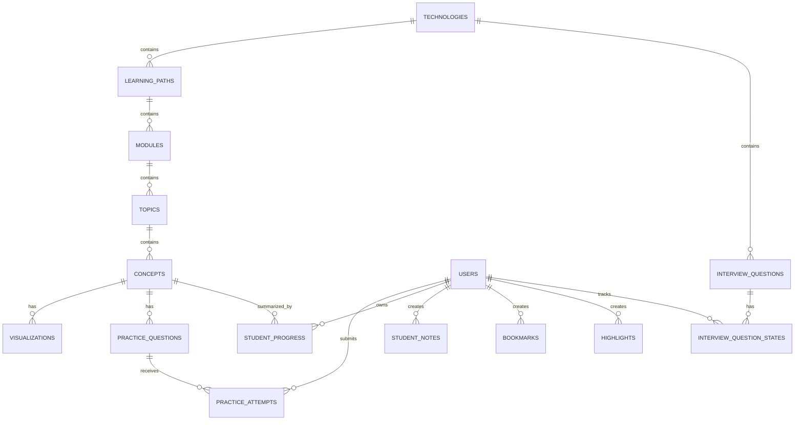

# DeepLearner Database Design v1.0

**Status:** Implementation-ready baseline  
**Database:** MongoDB Atlas (managed MongoDB)  
**ODM:** Mongoose + TypeScript  
**Primary application architecture:** Node.js/Express modular monolith with Next.js student app and React admin app  
**Target initial scale:** ~1,000 users

## 1. Purpose
This document defines the MongoDB data model for DeepLearner. It turns the approved PRD and System Architecture into concrete collection boundaries, relationships, indexing rules, security conventions, lifecycle rules, and transaction boundaries. The design intentionally favors a balanced MongoDB model: reference independently growing data; embed bounded editorial data that belongs to a single aggregate.

## 2. Locked Design Principles
- One MongoDB Atlas database per environment; development and production data are isolated.
- Use MongoDB ObjectId internally and human-readable slugs for public URLs.
- Concept is the central educational unit.
- Use references for hierarchy, visualizations, questions, attempts, progress, user-generated data and operational logs.
- Embed bounded Read/Example/Revise/source/completion data inside concepts.
- Keep one studentProgress document per user + concept; derive higher-level percentages initially.
- Store every practice attempt as an immutable record; never overwrite the first score.
- Use limited denormalization of hierarchy IDs for common queries, but never duplicate full parent documents.
- Use TTL indexes for verification/reset/session expiry data.
- Store refresh tokens and one-time tokens only as hashes.
- Store media bytes in S3; MongoDB stores metadata only.
- Use append-only audit and analytics event collections.
- Use MongoDB transactions only for multi-document invariants that must commit together.
- Use schemaVersion on complex documents such as concepts and visualizations.
- Archive published content; use soft deletion for operational records where deletion is necessary.

## 3. High-Level Relationship Model


## 4. Collection Catalog
| Domain | Collection | Responsibility |
|---|---|---|
| Identity & access | `users` | Primary user profile, role, plan and linked auth providers. |
| Identity & access | `sessions` | Refresh-token-backed login sessions and revocation state. |
| Identity & access | `emailVerificationTokens` | Short-lived hashed email verification tokens. |
| Identity & access | `passwordResetTokens` | Short-lived hashed password reset tokens. |
| Learning catalog | `technologies` | Top-level technology catalog such as JavaScript, React and Docker. |
| Learning catalog | `learningPaths` | Ordered learning journeys within a technology. |
| Learning catalog | `modules` | Ordered sections inside a learning path. |
| Learning catalog | `topics` | Ordered topics inside a module. |
| Learning catalog | `concepts` | Central educational unit: Read, Example, Revise, source and completion rules. |
| Learning content | `visualizations` | Visualization definitions, execution steps, nodes/edges and asset references. |
| Learning content | `practiceQuestions` | Coding, output, descriptive and scenario questions. |
| Learning content | `interviewQuestions` | Dedicated interview Q&A content. |
| Student learning | `practiceAttempts` | Immutable submitted practice attempts. |
| Learning content | `practiceRubricVersions` | F038 B2 private immutable OUTPUT rubric definitions; internal diagnostic grading only. |
| Content operations | `practiceRubricAuthorities` | F038 B2 independent review provenance, terminal revocation and transactional decision fence. |
| Student learning | `practiceAssessments` | F038 B2 private append-only DIAGNOSTIC results linked to owned attempts; never completion evidence. |
| Student learning | `studentProgress` | One summarized progress document per student + concept. |
| Student learning | `studentNotes` | Private concept-linked notes. |
| Student learning | `bookmarks` | Polymorphic bookmarks for concepts/topics/interview questions. |
| Student learning | `highlights` | Private text/content highlights tied to concepts. |
| Student learning | `interviewQuestionStates` | Know / Need Revision / Important state per student/question. |
| Student learning | `studySessions` | Study-time sessions for dashboard and aggregate analytics. |
| Gamification | `badges` | Badge definitions. |
| Gamification | `studentBadges` | Awarded badges per student. |
| Communication | `notifications` | In-app notifications per student. |
| Content operations | `contentReports` | Student reports for incorrect/outdated/broken content. |
| Content operations | `contentApprovals` | Review/approval actions for publishable content. |
| Content operations | `aiGenerations` | AI generation metadata, usage, status and output references. |
| Content operations | `mediaAssets` | Metadata for files stored in AWS S3. |
| Operations | `auditLogs` | Append-only Admin/security audit trail. |
| Operations | `analyticsEvents` | Append-only learning/product events for aggregate analytics. |
| Commercial (future-ready) | `subscriptions` | Optional future subscription/payment state; dormant during development. |

## 5. Content Hierarchy
```text
Technology → LearningPath → Module → Topic → Concept
```
Each hierarchy level is a separate collection. Parent-child relationships use ObjectId references, while frequently queried ancestor IDs may also be copied into descendants as limited denormalization. Ordering is stored on the child document (`order`).

### Content payload recommendation
For V1, store textual technical content as sanitized **Markdown** rather than raw HTML. This supports code fences, lists, callouts and links while keeping rendering controlled. If a richer block editor becomes necessary later, migrate using `schemaVersion` rather than mixing unversioned payload shapes.

## 6. Major Collection Schemas
### `users`
| Field | Type | Required | Purpose |
|---|---|---:|---|
| `_id` | `ObjectId` | Yes | MongoDB primary key. |
| `email` | `string` | Yes | Normalized lowercase email; unique. |
| `passwordHash` | `string | null` | Conditional | Argon2id hash for credential users; null for Google-only accounts. |
| `displayName` | `string` | Yes | Student/Admin display name. |
| `role` | `STUDENT | ADMIN` | Yes | Authorization role. |
| `plan` | `FREE | PREMIUM` | Yes | Commercial plan marker; development defaults may grant all entitlements. |
| `status` | `ACTIVE | DISABLED` | Yes | Account operational state. |
| `emailVerifiedAt` | `date | null` | No | Set after credential email verification; Google users may be treated verified. |
| `authProviders` | `array<object>` | Yes | Linked providers such as {provider, providerUserId}. |
| `onboarding` | `object` | No | Technologies, level, goal, preferred difficulty, daily target. |
| `createdAt / updatedAt` | `date` | Yes | Audit timestamps. |

### `sessions`
| Field | Type | Required | Purpose |
|---|---|---:|---|
| `_id` | `ObjectId` | Yes | Session id. |
| `userId` | `ObjectId` | Yes | Reference to users. |
| `refreshTokenHash` | `string` | Yes | Hash only; never store raw refresh token. |
| `deviceInfo` | `object` | No | User agent / device label; avoid excessive fingerprinting. |
| `ipHash` | `string | null` | No | Optional privacy-preserving operational signal. |
| `expiresAt` | `date` | Yes | TTL expiration target. |
| `revokedAt` | `date | null` | No | Revocation timestamp. |
| `createdAt / lastUsedAt` | `date` | Yes | Session lifecycle timestamps. |

### `technologies`
| Field | Type | Required | Purpose |
|---|---|---:|---|
| `_id` | `ObjectId` | Yes | Primary key. |
| `name` | `string` | Yes | e.g., JavaScript. |
| `slug` | `string` | Yes | Globally unique public URL slug. |
| `description` | `string` | No | Catalog summary. |
| `iconAssetId` | `ObjectId | null` | No | Reference to mediaAssets. |
| `status` | `DRAFT | PUBLISHED | ARCHIVED` | Yes | Catalog publishing state. |
| `order` | `number` | Yes | Display order. |
| `createdBy / updatedBy` | `ObjectId` | Yes | Admin references. |
| `createdAt / updatedAt` | `date` | Yes | Audit timestamps. |

### `learningPaths`
| Field | Type | Required | Purpose |
|---|---|---:|---|
| `_id` | `ObjectId` | Yes | Primary key. |
| `technologyId` | `ObjectId` | Yes | Parent technology. |
| `title` | `string` | Yes | Learning path title. |
| `slug` | `string` | Yes | Unique within technology. |
| `description` | `string` | No | Path summary. |
| `targetLevel` | `string` | No | Beginner/intermediate/advanced. |
| `completionScore` | `number` | Yes | Default minimum percentage; typically 70. |
| `status` | `DRAFT | PUBLISHED | ARCHIVED` | Yes | Publishing state. |
| `order` | `number` | Yes | Display order. |
| `createdBy / updatedBy` | `ObjectId` | Yes | Admin references. |
| `createdAt / updatedAt` | `date` | Yes | Audit timestamps. |

**F017 approved refinements:** title is trimmed/nonblank, 1–120 characters; slug is strict lowercase ASCII kebab-case, 1–100; description maximum 2000. targetLevel is optional BEGINNER/INTERMEDIATE/ADVANCED, default null. completionScore is an integer 0–100, default 70, representing the future minimum completion threshold; F017 performs no completion calculations. status defaults to DRAFT; order defaults to 0 and must be a nonnegative safe integer. Required createdBy/updatedBy references represent Admin provenance, not proof that an Admin exists. Mongoose references do not enforce parent existence or role. Strict schema, timestamps, internal __v; automatic collection/index creation and command buffering disabled. Archived paths retain their parent-scoped slug reservation; no global slug/title uniqueness or TTL. Public reads require a published path and published parent. No provisioning or authoring workflow is included.

### `modules`
| Field | Type | Required | Purpose |
|---|---|---:|---|
| `_id` | `ObjectId` | Yes | Primary key. |
| `technologyId` | `ObjectId` | Yes | Denormalized parent for efficient filtering. |
| `learningPathId` | `ObjectId` | Yes | Parent learning path. |
| `title / slug` | `string` | Yes | Module identity; slug unique within learning path. |
| `description` | `string` | No | Module summary. |
| `order` | `number` | Yes | Path ordering. |
| `status` | `DRAFT | PUBLISHED | ARCHIVED` | Yes | Publishing state. |
| `createdAt / updatedAt` | `date` | Yes | Audit timestamps. |

**F018 approved refinements:** title trimmed/nonblank, 1-120; strict lowercase ASCII
kebab-case slug, 1-100; optional description maximum 2000. Status defaults to DRAFT;
order defaults to 0 and is a nonnegative safe integer. Required Technology and
Learning Path ObjectId references; no Admin provenance fields. Strict schema,
timestamps and internal __v. Automatic collection/index creation and buffering
disabled. Unique { learningPathId: 1, slug: 1 } includes archived records;
{ learningPathId: 1, status: 1, order: 1 } supports reads. No global slug/title
uniqueness or TTL. Public reads require all ancestors published and consistent
denormalized technologyId. References alone do not enforce foreign keys; future
authoring must derive Technology from the validated Learning Path. No repair,
publication or provisioning workflow is included.

### `topics`
| Field | Type | Required | Purpose |
|---|---|---:|---|
| `_id` | `ObjectId` | Yes | Primary key. |
| `technologyId` | `ObjectId` | Yes | Denormalized parent. |
| `learningPathId` | `ObjectId` | Yes | Denormalized parent. |
| `moduleId` | `ObjectId` | Yes | Parent module. |
| `title / slug` | `string` | Yes | Topic identity; slug unique within module. |
| `description` | `string` | No | Topic summary. |
| `order` | `number` | Yes | Module ordering. |
| `status` | `DRAFT | PUBLISHED | ARCHIVED` | Yes | Publishing state. |
| `createdAt / updatedAt` | `date` | Yes | Audit timestamps. |

**F019 approved refinements:** title trimmed/nonblank, 1-120; strict lowercase ASCII
kebab-case slug, 1-100; optional description maximum 2000. Status defaults to DRAFT;
order defaults to 0 and is a nonnegative safe integer. Required Technology,
Learning Path and Module ObjectId references; no Admin provenance or completion
fields. Strict schema, timestamps and internal __v. Automatic collection/index
creation and buffering disabled. Unique { moduleId: 1, slug: 1 } includes archived
records; { moduleId: 1, status: 1, order: 1 } supports reads. Cross-module slug reuse
is allowed; no global slug/title uniqueness or TTL. Public reads require all four
levels published and all denormalized IDs consistent, with identical list/count
predicates. References are not foreign keys; future authoring must derive ancestors
from the validated Module. F019 adds no write, repair or provisioning workflow.

### `concepts`
| Field | Type | Required | Purpose |
|---|---|---:|---|
| `_id` | `ObjectId` | Yes | Primary key and central learning unit. |
| `technologyId` | `ObjectId` | Yes | Denormalized parent for common queries. |
| `learningPathId` | `ObjectId` | Yes | Denormalized parent. |
| `moduleId` | `ObjectId` | Yes | Denormalized parent. |
| `topicId` | `ObjectId` | Yes | Direct parent. |
| `title / slug` | `string` | Yes | Concept identity; slug unique within topic. |
| `difficulty` | `BEGINNER | INTERMEDIATE | ADVANCED | INTERVIEW_READY` | Yes | Learning difficulty. |
| `contentFormat` | `MARKDOWN` | Yes | Recommended V1 format; raw HTML disallowed by default. |
| `read` | `object` | Yes | Core explanation, why it matters, how it works, key points/common mistakes. |
| `examples` | `array<object>` | No | Embedded examples and real-world analogies; bounded editorial content. |
| `revise` | `object` | No | Short summary, key points, memory trick and important code. |
| `source` | `object` | Yes | Required source label, URL, sourceType and isOfficial flag. |
| `completionRules` | `object` | Yes | Required sections and minimum score; default 70%. |
| `status` | `content status enum` | Yes | DRAFT → AI_GENERATED → IN_REVIEW → CHANGES_REQUIRED → APPROVED → PUBLISHED → ARCHIVED. |
| `previousPublishedSnapshot` | `object | null` | No | Lightweight previous published snapshot only. |
| `schemaVersion` | `number` | Yes | Starts at 1. |
| `publishedAt / publishedBy` | `date / ObjectId` | No | Publication metadata. |
| `createdBy / updatedBy` | `ObjectId` | Yes | Admin references. |
| `createdAt / updatedAt` | `date` | Yes | Audit timestamps. |

### `visualizations`
| Field | Type | Required | Purpose |
|---|---|---:|---|
| `_id` | `ObjectId` | Yes | Primary key. |
| `conceptId` | `ObjectId` | Yes | Owner concept. |
| `technologyId / topicId` | `ObjectId` | Yes | Limited denormalization for filtering. |
| `type` | `enum` | Yes | FLOWCHART, ANIMATED_FLOW, ARCHITECTURE, MIND_MAP, TIMELINE, COMPARISON, SEQUENCE, TREE, PROCESS, CHART, GRAPH, STEP_BY_STEP, MEMORY_EXECUTION, CODE_VISUALIZER. |
| `title` | `string` | Yes | Visualization label. |
| `nodes / edges` | `array<object>` | Type-dependent | Structured graph/diagram model. |
| `steps` | `array<object>` | No | Ordered execution/animation steps. |
| `animationConfig` | `object` | No | Playback defaults such as speed and transitions. |
| `assetIds` | `array<ObjectId>` | No | References to mediaAssets. |
| `status` | `content status enum` | Yes | Approval/publishing state. |
| `schemaVersion` | `number` | Yes | Visualization renderer contract version. |
| `createdBy / updatedBy` | `ObjectId` | Yes | Admin references. |
| `createdAt / updatedAt` | `date` | Yes | Audit timestamps. |

### F026 approved visualization v1 refinement

F026 implements the separate visualizations model only. ANIMATED_FLOW is the
sole accepted v1 type; the PRD's execution-flow/animations example is illustrative.
Use schemaVersion 1 and canonical animationConfig. Other types/assets remain
deferred. No Concept record, API, migration or automatic index creation changes.
See [the approved F026 contract](features/F026-visualization-data-model.md).

Required title (1-120) and textAlternative (1-4000) are trimmed inert text.
Required arrays contain 1-50 nodes, 0-100 edges and 1-100 ordered steps. Nodes
have id, label (1-120) and optional description (1-1000); edges have id, source,
target and label (1-120); steps have title (1-120), explanation (1-2000), nodeIds
(1-50) and edgeIds (0-100). IDs fully match `[a-z][a-z0-9-]{0,63}`. Node and edge
namespaces are independently unique within a document. Endpoints and step
references must resolve locally; step reference arrays cannot contain duplicates.
Cycles, self-loops, parallel edges and unused nodes are allowed. No nested _id.

Optional animationConfig stays absent when omitted. When present it requires
integer stepDurationMs 100-10000 and explicit Boolean autoplay=false. Missing,
true, null or coerced autoplay fails; no default is inserted. All nested fields
are strict and coercion is rejected. Exact 24-hex strings or genuine ObjectIds
are accepted for Concept/Topic/Technology/User references, without lookups.

The normalized authored JSON projection is capped at 262144 UTF-8 bytes. Graph
integrity and aggregate checks run on async validate()/validated save();
validateSync() alone does not run these middleware checks. Raw collection and
query updates are not the approved validation boundary. This is not a database
validator or foreign-key/role constraint. Future services own ancestry, Admin
identity, visibility, authorization and lifecycle-transition enforcement.

Existing seven-state lifecycle defaults to DRAFT, schemaVersion defaults to 1,
Mongoose timestamps and __v remain internal. Preserve both nonunique indexes
listed below and standard unique _id; multiple Concept/type records are allowed.
Source code-like text is inert, never evaluated or fetched. Future renderers must
escape it as text and enforce accessibility; F026 supplies no rendering behavior.

### `practiceQuestions`
| Field | Type | Required | Purpose |
|---|---|---:|---|
| `_id` | `ObjectId` | Yes | Primary key. |
| `technologyId / topicId / conceptId` | `ObjectId` | Yes | Denormalized content ownership. |
| `type` | `CODING | OUTPUT | DESCRIPTIVE | SCENARIO` | Yes | Question type. |
| `difficulty` | `enum` | Yes | Question difficulty. |
| `prompt` | `string/markdown` | Yes | Question shown before submission. |
| `starterCode` | `string | null` | No | For JS/TS coding questions. |
| `language` | `JAVASCRIPT | TYPESCRIPT | null` | No | Coding language. |
| `answer` | `string/markdown` | Yes | Locked until student submits attempt. |
| `explanation` | `string/markdown` | No | Post-submission explanation. |
| `evaluation` | `object` | No | Scoring rubric or expected output; V1 may include manual/self-evaluation for descriptive answers. |
| `status` | `content status enum` | Yes | Approval/publishing state. |
| `createdBy / updatedBy` | `ObjectId` | Yes | Admin references. |
| `createdAt / updatedAt` | `date` | Yes | Audit timestamps. |

### F030 approved practice question refinement

F030 implements only the `practiceQuestions` model. See the
[approved contract](features/F030-practice-question-base-model.md).
Question types remain CODING, OUTPUT, DESCRIPTIVE and SCENARIO; difficulty reuses
BEGINNER, INTERMEDIATE, ADVANCED and INTERVIEW_READY. Prompt/answer are required;
explanation is optional. These strings are trimmed, nonblank and bounded at
50,000 characters each. Optional `starterCode` is inert question context for
**all four types**, superseding the coding-only description above. Preserve its
whitespace; reject blank/non-string code and lengths over 50,000. Language remains
JAVASCRIPT or TYPESCRIPT, required when code is non-null; it may exist without code.
Code/language may be absent or explicitly null; explanation may be absent but not
null. No implicit type coercion or unknown/evaluation fields are accepted.

Canonical lifecycle defaults to DRAFT; schemaVersion is added as integer 1 only,
default 1. Timestamps and required User provenance references follow existing
conventions. Exact ObjectIds/24-hex strings validate identifier format only, not
parent existence, ancestry or Admin authority. Both documented indexes remain
nonunique; autoCreate/autoIndex/buffering are disabled. No migration or startup
collection/index creation is introduced.

Answer and explanation use default query exclusion (`select: false`), not answer
authorization or universal redaction. Whole-document conditional validation requires
async validate()/validated save with the needed fields loaded; query/raw writes
are not this validation boundary. The unspecified `evaluation` object remains a
future requirement and is explicitly unsupported/rejected in F030; no Mixed/Map
or arbitrary JSON substitute. No grading, attempts, publishing or UI is implemented.

### `practiceAttempts`
| Field | Type | Required | Purpose |
|---|---|---:|---|
| `_id` | `ObjectId` | Yes | Immutable attempt id. |
| `userId` | `ObjectId` | Yes | Student. |
| `questionId` | `ObjectId` | Yes | Practice question. |
| `conceptId` | `ObjectId` | Yes | Denormalized concept. |
| `attemptNumber` | `number` | Yes | Sequence for user + question. |
| `studentAnswer` | `string/object` | Yes | Submitted answer/code/output. |
| `score` | `number` | Yes | Normalized 0–100 when objectively scorable. |
| `result` | `PASS | FAIL | SUBMITTED` | Yes | Supports descriptive submissions without automatic numeric scoring. |
| `submittedAt` | `date` | Yes | Submission time. |
| `metadata` | `object` | No | Execution result, duration or evaluator metadata; no secrets. |

### `studentProgress`
| Field | Type | Required | Purpose |
|---|---|---:|---|
| `_id` | `ObjectId` | Yes | Primary key. |
| `userId` | `ObjectId` | Yes | Student. |
| `conceptId` | `ObjectId` | Yes | One document per student + concept. |
| `technologyId / learningPathId / moduleId / topicId` | `ObjectId` | Yes | Denormalized hierarchy for dashboards. |
| `sections` | `object` | Yes | readCompleted, visualizeCompleted, exampleCompleted, practiceCompleted, reviseCompleted. |
| `firstScore` | `number | null` | No | Never overwritten after first scored attempt. |
| `latestScore` | `number | null` | No | Most recent score. |
| `bestScore` | `number | null` | No | Highest score. |
| `attemptCount` | `number` | Yes | Aggregate count. |
| `mastery` | `WEAK | IMPROVING | STRONG` | Yes | Default derived from thresholds. |
| `status` | `NOT_STARTED | IN_PROGRESS | COMPLETED` | Yes | Concept completion state. |
| `startedAt / lastActivityAt / completedAt` | `date` | No | Lifecycle timestamps. |
| `updatedAt` | `date` | Yes | Summary update time. |

### `interviewQuestions`
| Field | Type | Required | Purpose |
|---|---|---:|---|
| `_id` | `ObjectId` | Yes | Primary key. |
| `technologyId` | `ObjectId` | Yes | Technology owner. |
| `topicId` | `ObjectId | null` | No | Optional topic reference. |
| `difficulty` | `enum` | Yes | Beginner/intermediate/advanced/interview-ready. |
| `question` | `string/markdown` | Yes | Interview question. |
| `answer` | `string/markdown` | Yes | Displayed via Show Answer. |
| `explanation` | `string/markdown` | No | Supporting explanation. |
| `followUpQuestions` | `array<string>` | No | Bounded editorial list. |
| `status` | `content status enum` | Yes | Approval/publishing state. |
| `createdAt / updatedAt` | `date` | Yes | Audit timestamps. |

### `aiGenerations`
| Field | Type | Required | Purpose |
|---|---|---:|---|
| `_id` | `ObjectId` | Yes | Primary key. |
| `adminId` | `ObjectId` | Yes | Admin who requested generation. |
| `feature` | `string` | Yes | LESSON, PRACTICE, FLASHCARDS, VISUALIZATION_SUGGESTION, INTERVIEW, etc. |
| `targetRef` | `object` | No | Technology/topic/concept being generated. |
| `provider` | `string` | Yes | Provider key without secrets. |
| `model` | `string` | Yes | Server-selected model. |
| `promptVersion` | `string` | Yes | Internal prompt template version. |
| `status` | `REQUESTED | SUCCEEDED | FAILED | APPROVED | REJECTED` | Yes | Generation lifecycle. |
| `outputReference` | `object | null` | No | Reference to draft/published resource, not giant duplicate content where avoidable. |
| `inputTokens / outputTokens` | `number` | No | Usage metrics. |
| `estimatedCost` | `number` | No | Cost estimate. |
| `errorCode` | `string | null` | No | Sanitized operational error. |
| `createdAt / completedAt` | `date` | Yes | Lifecycle timestamps. |

### `mediaAssets`
| Field | Type | Required | Purpose |
|---|---|---:|---|
| `_id` | `ObjectId` | Yes | Metadata id. |
| `storageProvider` | `S3` | Yes | Storage provider marker. |
| `bucket` | `string` | Yes | Bucket name; environment-specific. |
| `key` | `string` | Yes | Unique object key. |
| `mimeType` | `string` | Yes | Allowed image/svg/gif MIME type. |
| `sizeBytes` | `number` | Yes | Upload size. |
| `checksum` | `string | null` | No | Integrity/deduplication support. |
| `uploadedBy` | `ObjectId` | Yes | Admin uploader. |
| `status` | `PENDING | READY | FAILED | DELETED` | Yes | Upload lifecycle. |
| `createdAt / updatedAt` | `date` | Yes | Audit timestamps. |

### `analyticsEvents`
| Field | Type | Required | Purpose |
|---|---|---:|---|
| `_id` | `ObjectId` | Yes | Event id. |
| `userId` | `ObjectId | null` | No | Authenticated user when applicable. |
| `eventType` | `string` | Yes | e.g., concept_started, practice_submitted. |
| `technologyId / conceptId / questionId` | `ObjectId | null` | No | Relevant entity references. |
| `sessionId` | `ObjectId | null` | No | Optional study/session correlation. |
| `metadata` | `object` | No | Small event-specific metadata; avoid content bodies/PII. |
| `createdAt` | `date` | Yes | Event time; append-only. |

## 7. Supporting Collections
- **`emailVerificationTokens`** — `userId`, `tokenHash`, `expiresAt`, `usedAt`, `createdAt`. Raw token is sent to the user but never stored.
- **`passwordResetTokens`** — Same token-storage pattern as verification tokens; password reset should revoke active sessions after success.
- **`studentNotes`** — `userId`, `conceptId`, `bodyMarkdown`, `createdAt`, `updatedAt`. Private to the student.
- **`bookmarks`** — `userId`, `resourceType`, `resourceId`, `createdAt`. Polymorphic resource types are restricted to an allow-list.
- **`highlights`** — `userId`, `conceptId`, stable content anchor/section key, selected text snapshot, optional note, timestamps.
- **`interviewQuestionStates`** — `userId`, `interviewQuestionId`, `state` (`KNOW`, `NEED_REVISION`, `IMPORTANT`), timestamps.
- **`studySessions`** — `userId`, start/end times, duration, optional active concept/path refs. Used for study-time analytics; client heartbeat/visibility rules should prevent inflated time.
- **`badges`** — Stable `code`, title, description, icon asset, award rule metadata and active flag.
- **`studentBadges`** — `userId`, `badgeId`, `awardedAt`, reason/trigger metadata.
- **`notifications`** — `userId`, type, title, message, `isRead`, `actionUrl`, timestamps.
- **`contentReports`** — Reporter, resource type/id, reason, details, status, reviewer/admin resolution and timestamps.
- **`contentApprovals`** — Resource type/id, action (`SUBMIT_REVIEW`, `REQUEST_CHANGES`, `APPROVE`, `PUBLISH`, `ARCHIVE`), actor, optional comment, timestamp.
- **`auditLogs`** — Actor, action, resource, request correlation id, sanitized metadata and timestamp. Append-only from application perspective.

F038 B2 extends existing auditLogs with CONTENT_APPROVAL rubric authored/approved/
revoked events. Actor is the verified current Admin; resource is the immutable
rubric definition; metadata is exactly {rubricVersion}. Preserve existing Auth/
User subject and metadata rules through separate strict event discrimination.
Required approval/revocation audit writes share the domain transaction; failure
rolls back, and uncertain proof grants no authority. No generic logging/read API.
- **`subscriptions`** — Future-ready collection for payment-provider state. Do not create payment logic in V1; user.plan remains sufficient during development.

## 8. Index Strategy
Indexes should be created intentionally from real query patterns. Do not index every field; indexes increase storage and write cost.
### `users` indexes
| Key | Kind | Purpose |
|---|---|---|
| `{ email: 1 }` | unique | Login lookup and email uniqueness. |
| `{ role: 1, status: 1 }` | standard | Admin user management. |
| `{ "authProviders.providerUserId": 1 }` | sparse / verify | Fast Google identity lookup; application also prevents duplicate linkage. |

### `sessions` indexes
| Key | Kind | Purpose |
|---|---|---|
| `{ refreshTokenHash: 1 }` | unique | Refresh-token lookup by hash. |
| `{ userId: 1, revokedAt: 1 }` | standard | List/revoke active sessions. |
| `{ expiresAt: 1 }` | TTL expireAfterSeconds: 0 | Automatic expiry cleanup. |

### `emailVerificationTokens` indexes
| Key | Kind | Purpose |
|---|---|---|
| `{ tokenHash: 1 }` | unique | Verify token by hash. |
| `{ expiresAt: 1 }` | TTL | Automatic cleanup. |

### `passwordResetTokens` indexes
| Key | Kind | Purpose |
|---|---|---|
| `{ tokenHash: 1 }` | unique | Reset token by hash. |
| `{ expiresAt: 1 }` | TTL | Automatic cleanup. |

### `technologies` indexes
| Key | Kind | Purpose |
|---|---|---|
| `{ slug: 1 }` | unique | Public URL lookup. |
| `{ status: 1, order: 1 }` | standard | Published catalog ordering. |

### `learningPaths` indexes
| Key | Kind | Purpose |
|---|---|---|
| `{ technologyId: 1, slug: 1 }` | unique | Path URL uniqueness within technology. |
| `{ technologyId: 1, status: 1, order: 1 }` | standard | Published path navigation. |

### `modules` indexes
| Key | Kind | Purpose |
|---|---|---|
| `{ learningPathId: 1, slug: 1 }` | unique | Module slug within path. |
| `{ learningPathId: 1, status: 1, order: 1 }` | standard | Path module ordering. |

### `topics` indexes
| Key | Kind | Purpose |
|---|---|---|
| `{ moduleId: 1, slug: 1 }` | unique | Topic slug within module. |
| `{ moduleId: 1, status: 1, order: 1 }` | standard | Module topic ordering. |

### `concepts` indexes
| Key | Kind | Purpose |
|---|---|---|
| `{ topicId: 1, slug: 1 }` | unique | Concept slug within topic. |
| `{ topicId: 1, status: 1, order: 1 }` | standard | Published topic concepts. |
| `{ technologyId: 1, status: 1, difficulty: 1 }` | standard | Catalog/filter queries. |
| `{ updatedAt: -1 }` | standard | Admin content queue. |

### `visualizations` indexes
| Key | Kind | Purpose |
|---|---|---|
| `{ conceptId: 1, status: 1 }` | standard | Concept visualization load. |
| `{ conceptId: 1, type: 1 }` | standard | Visualization filtering. |

### `practiceQuestions` indexes
| Key | Kind | Purpose |
|---|---|---|
| `{ conceptId: 1, status: 1, difficulty: 1 }` | standard | Practice retrieval. |
| `{ technologyId: 1, type: 1, status: 1 }` | standard | Admin/question-bank filters. |

### `practiceAttempts` indexes
| Key | Kind | Purpose |
|---|---|---|
| `{ userId: 1, questionId: 1, attemptNumber: 1 }` | unique | Attempt sequencing. |
| `{ userId: 1, conceptId: 1, submittedAt: -1 }` | standard | Concept attempt history. |
| `{ conceptId: 1, submittedAt: -1 }` | standard | Aggregate content performance. |

### `studentProgress` indexes
| Key | Kind | Purpose |
|---|---|---|
| `{ userId: 1, conceptId: 1 }` | unique | One progress summary per student/concept. |
| `{ userId: 1, learningPathId: 1, status: 1 }` | standard | Dashboard/path progress. |
| `{ conceptId: 1, mastery: 1 }` | standard | Aggregate weak-topic analytics. |

### `studentNotes` indexes
| Key | Kind | Purpose |
|---|---|---|
| `{ userId: 1, conceptId: 1, updatedAt: -1 }` | standard | Student concept notes. |

### `bookmarks` indexes
| Key | Kind | Purpose |
|---|---|---|
| `{ userId: 1, resourceType: 1, resourceId: 1 }` | unique | Prevent duplicate bookmarks. |
| `{ userId: 1, createdAt: -1 }` | standard | Bookmark list. |

### `highlights` indexes
| Key | Kind | Purpose |
|---|---|---|
| `{ userId: 1, conceptId: 1, createdAt: -1 }` | standard | Concept highlights. |

### `interviewQuestions` indexes
| Key | Kind | Purpose |
|---|---|---|
| `{ technologyId: 1, topicId: 1, difficulty: 1, status: 1 }` | standard | Interview browsing. |

### `interviewQuestionStates` indexes
| Key | Kind | Purpose |
|---|---|---|
| `{ userId: 1, interviewQuestionId: 1 }` | unique | One state per student/question. |
| `{ userId: 1, state: 1, updatedAt: -1 }` | standard | Revision/important filters. |

### `studySessions` indexes
| Key | Kind | Purpose |
|---|---|---|
| `{ userId: 1, startedAt: -1 }` | standard | Student study history. |
| `{ startedAt: -1 }` | standard | Aggregate activity windows. |

### `badges` indexes
| Key | Kind | Purpose |
|---|---|---|
| `{ code: 1 }` | unique | Stable badge identifier. |

### `studentBadges` indexes
| Key | Kind | Purpose |
|---|---|---|
| `{ userId: 1, badgeId: 1 }` | unique | Prevent duplicate awards. |
| `{ userId: 1, awardedAt: -1 }` | standard | Student badge list. |

### `notifications` indexes
| Key | Kind | Purpose |
|---|---|---|
| `{ userId: 1, isRead: 1, createdAt: -1 }` | standard | Unread/read notification list. |

### `contentReports` indexes
| Key | Kind | Purpose |
|---|---|---|
| `{ status: 1, createdAt: -1 }` | standard | Admin report queue. |
| `{ resourceType: 1, resourceId: 1, status: 1 }` | standard | Open reports by content. |

### `contentApprovals` indexes
| Key | Kind | Purpose |
|---|---|---|
| `{ resourceType: 1, resourceId: 1, createdAt: -1 }` | standard | Approval history. |

### `aiGenerations` indexes
| Key | Kind | Purpose |
|---|---|---|
| `{ adminId: 1, createdAt: -1 }` | standard | Admin AI history. |
| `{ status: 1, createdAt: -1 }` | standard | Operations/usage review. |
| `{ targetRef.resourceId: 1, createdAt: -1 }` | sparse | Trace AI generations for resource. |

### `mediaAssets` indexes
| Key | Kind | Purpose |
|---|---|---|
| `{ bucket: 1, key: 1 }` | unique | S3 object uniqueness. |
| `{ status: 1, createdAt: 1 }` | standard | Cleanup pending/failed assets. |

### `auditLogs` indexes
| Key | Kind | Purpose |
|---|---|---|
| `{ actorId: 1, createdAt: -1 }` | standard | Actor audit history. |
| `{ resourceType: 1, resourceId: 1, createdAt: -1 }` | standard | Resource audit history. |
| `{ action: 1, createdAt: -1 }` | standard | Security/operations review. |

### `analyticsEvents` indexes
| Key | Kind | Purpose |
|---|---|---|
| `{ eventType: 1, createdAt: -1 }` | standard | Event trend queries. |
| `{ userId: 1, createdAt: -1 }` | standard | User event correlation when necessary. |
| `{ conceptId: 1, eventType: 1, createdAt: -1 }` | sparse | Content analytics. |

### F038 B2 diagnostic indexes

| Collection / name | Exact ordered key | Constraint |
| --- | --- | --- |
| practiceRubricVersions / uq_practice_rubric_version | {rubricId:1,version:1} | UNIQUE |
| practiceRubricAuthorities / uq_practice_rubric_authority | {rubricId:1,version:1} | UNIQUE |
| practiceAssessments / uq_practice_assessment_identity | {userId:1,attemptId:1,rubricId:1,rubricVersion:1,graderId:1,graderVersion:1} | UNIQUE |

Default _id indexes also apply. B2 requires the exact name, ordered key, unique=true
and v=2 with no additional options; missing/incorrect/unverifiable readiness fails
closed. No automatic collection/index creation. Provision only under separately
approved, verified disposable integration; no persistent provisioning authority.
No new audit index, completion/history/analytics consumer or migration is added.

## 9. Key Query Patterns
- **Published learning tree:** Load published paths/modules/topics/concepts in ordered batches using parent ID + status + order indexes. Avoid one giant nested document.
- **Open a concept:** Fetch concept by topicId + slug (or _id), then fetch published visualizations and practice questions in parallel.
- **Student dashboard:** Query studentProgress by userId and active learningPathId, plus recent studySessions/bookmarks/notifications. Higher-level percentages are derived from concept summaries initially.
- **Weak topics:** Query studentProgress by userId + mastery=WEAK/IMPROVING; join content titles at service layer or via targeted aggregate.
- **Practice submission:** Insert practiceAttempts and update studentProgress atomically where the attempt changes summary values.
- **Admin approval queue:** Query content status + updatedAt; approval/audit history remains in separate append-only collections.
- **Content quality analytics:** Aggregate attempts/events by conceptId; do not write large analytics arrays into the concept document.
- **Interview browsing:** Filter interviewQuestions by technology/topic/difficulty/status; load user states separately by userId.

## 10. Transactions and Consistency Boundaries
Use transactions only when multiple MongoDB writes must succeed or fail together.
- Practice submission: insert attempt + update summarized studentProgress.
- Publish content: change content status/publication metadata + append required approval/audit record when strict workflow consistency is required.
- Badge award: create studentBadges + notification when duplicate awards must be prevented consistently.
- Password reset completion: update password hash + revoke active sessions + mark token used, if implemented across multiple documents.

F038 B2 keeps these workflows unchanged. Draft/approval/revocation and required
rubric audit records commit together. Diagnostic grading/replay and revocation
conditionally write the same approval-authority fence; a snapshot read alone is
insufficient. New assessment plus fence write is atomic, with exact unique
identity, bounded retries, majority+journal commit and owned majority proof.
Audit/fence/assessment failure rolls back; uncertain outcome returns no result.
No B2 transaction updates F036 attempts, F037 progress or completion/mastery.
Do **not** use a MongoDB transaction to coordinate S3. Use an application-level state machine (`PENDING → READY`), idempotency, and cleanup for orphaned objects.

## 11. Practice Attempt + Progress Algorithm
```text
Submit answer
  ↓
Validate question and user
  ↓
Evaluate / record submission
  ↓
Transaction
  ├─ Insert immutable practiceAttempt
  └─ Upsert studentProgress summary
       ├─ preserve firstScore
       ├─ update latestScore
       ├─ max(bestScore, score)
       ├─ increment attemptCount
       ├─ recalculate mastery
       └─ evaluate concept completion
  ↓
Return unlocked official answer + explanation
```

## 12. Completion and Mastery Rules
Default concept completion requires configured sections plus the configured minimum practice score (70% by default). `studentProgress` stores the resulting summary, while the source of truth for individual answers remains `practiceAttempts`. Default mastery thresholds are Weak <60%, Improving 60–79%, Strong 80–100%; make thresholds configurable rather than hard-coded across services.

## 13. AI Data Model
AI is operational assistance, not the source of truth. `aiGenerations` records who requested generation, provider/model, prompt template version, status, usage and output references. Approved content is copied/normalized into ordinary content collections. API keys and provider secrets must never be stored in MongoDB documents.

## 14. Media/S3 Data Model
`mediaAssets` stores S3 metadata only. Upload lifecycle: `PENDING` metadata/intent → presigned upload → server verifies object metadata/type/size → `READY`. Content references assets by `mediaAssetId`. Deleting/archiving content must not automatically delete a shared asset until reference checks/cleanup rules confirm it is unused.

## 15. Security and Privacy
- Atlas TLS in transit and provider encryption at rest are mandatory baseline controls.
- Never store raw passwords, refresh tokens, email verification tokens, password reset tokens, AI keys or AWS secret keys.
- Normalize email before uniqueness checks.
- Use Argon2id for password hashing; store algorithm parameters with the hash representation.
- Keep user-generated notes/highlights private by query scoping on authenticated userId.
- Admin routes enforce RBAC at the API layer; database fields do not replace authorization checks.
- Sanitize Markdown/rendering; do not persist or render untrusted raw HTML by default.
- Audit security-sensitive Admin/auth actions without logging token values or content secrets.

## 16. Soft Delete, Archive and Retention
| Data | Rule |
|---|---|
| Published educational content | Prefer `ARCHIVED`; keep references valid for historical progress. |
| User accounts | V1 supports disable, not user self-deletion. |
| Sessions | TTL on `expiresAt`; revoked sessions may be retained until expiry for security visibility. |
| Verification/reset tokens | TTL cleanup after expiry; mark used when consumed. |
| Practice attempts | Retain as learning history; do not overwrite. |
| Analytics events | Retain during V1; define archival/TTL policy when volume becomes material. |
| Audit logs | Retain according to security/operational policy; append-only. |
| Media assets | Use lifecycle status and cleanup job for orphaned `PENDING/FAILED` objects. |

## 17. Environment Strategy
Use separate Atlas databases/projects for environments. Start with `deeplearner-dev`; create `deeplearner-prod` later. Never copy production credentials or student data into development. Use separate S3 prefixes/buckets and AI keys per environment as described in the System Architecture.

## 18. Backup and Recovery
Development may use free-tier limitations. Before production launch, enable an Atlas tier/backup strategy that supports required recovery objectives. Production design should define backup frequency, restore testing, retention, and who is authorized to perform restore operations. MongoDB backup is not a substitute for S3 object versioning/lifecycle decisions.

## 19. Schema Evolution
Mongoose provides runtime schemas, but production data still needs explicit migration discipline. Complex documents such as concepts and visualizations carry `schemaVersion`. Migrations should be idempotent where possible, tested against a development copy, and executed with rollback/backup planning. Avoid silent shape changes in application code.

## 20. Scaling Path
- V1 (~1,000 users): one Atlas database, normal collections, targeted indexes, application-level aggregates.
- When read volume grows: add cached summary fields/materialized aggregates only for proven hot queries.
- When analytics events become large: move long-term analytical workloads to a dedicated analytics/warehouse pipeline without changing transactional collection ownership.
- When search requirements grow: introduce Atlas Search/vector search rather than a separate search cluster first.
- Only shard collections when data/throughput actually requires it; current design does not need sharding.

## 21. Validation Rules
API input validation uses Zod; persistence constraints use Mongoose. Backend validation is authoritative. Important rules include: valid ObjectIds; status transitions; source required before publish; allowed visualization types; bounded arrays; allowed S3 MIME types; minimum/maximum content sizes; and valid completion score range 0–100.

## 22. Data Ownership by Backend Module
| Backend module | Owned collections |
|---|---|
| `auth` | users, sessions, emailVerificationTokens, passwordResetTokens |
| `catalog/content` | technologies, learningPaths, modules, topics, concepts |
| `visualization` | visualizations |
| `practice` | practiceQuestions, practiceAttempts |
| `progress` | studentProgress, studySessions |
| `student-personal` | studentNotes, bookmarks, highlights |
| `interview` | interviewQuestions, interviewQuestionStates |
| `gamification` | badges, studentBadges |
| `notifications` | notifications |
| `content-ops` | contentReports, contentApprovals |
| `ai` | aiGenerations |
| `media` | mediaAssets |
| `analytics` | analyticsEvents |
| `audit` | auditLogs |
| `commercial` | subscriptions (future) |

## 23. Important Implementation Rules
- Never use Mongoose `populate()` indiscriminately across deep hierarchy; prefer explicit, bounded queries/services.
- Always paginate admin lists, attempts, notifications, reports and audit/analytics data.
- Use projection to avoid returning answers before practice submission and to avoid exposing security fields.
- Create indexes through migrations/startup management rather than relying on uncontrolled auto-indexing in production.
- Use idempotency keys or duplicate protection for sensitive write APIs such as practice submission and AI generation requests.
- Use timestamps in UTC in the database; format to user locale at the presentation layer.
- Keep slugs immutable where practical after publication; if slug changes become necessary, introduce redirect metadata rather than silently breaking public URLs.

## 24. Example Concept Document
```json
{
  "_id": "ObjectId(...) / illustrative",
  "technologyId": "ObjectId(...) / JavaScript",
  "learningPathId": "ObjectId(...)",
  "moduleId": "ObjectId(...)",
  "topicId": "ObjectId(...)",
  "title": "JavaScript Event Loop",
  "slug": "event-loop",
  "difficulty": "INTERMEDIATE",
  "contentFormat": "MARKDOWN",
  "read": {
    "summary": "...",
    "bodyMarkdown": "..."
  },
  "examples": [
    {
      "title": "setTimeout ordering",
      "bodyMarkdown": "..."
    }
  ],
  "revise": {
    "summary": "...",
    "memoryTrick": "..."
  },
  "source": {
    "label": "MDN Web Docs",
    "url": "https://...",
    "sourceType": "OFFICIAL_OR_TRUSTED",
    "isOfficial": false
  },
  "completionRules": {
    "requiredSections": [
      "READ",
      "VISUALIZE",
      "EXAMPLE",
      "PRACTICE"
    ],
    "minimumScore": 70
  },
  "status": "PUBLISHED",
  "schemaVersion": 1
}
```

## 25. Example Student Progress Document
```json
{
  "userId": "ObjectId(...) ",
  "conceptId": "ObjectId(...) ",
  "technologyId": "ObjectId(...) ",
  "learningPathId": "ObjectId(...) ",
  "moduleId": "ObjectId(...) ",
  "topicId": "ObjectId(...) ",
  "sections": {
    "readCompleted": true,
    "visualizeCompleted": true,
    "exampleCompleted": true,
    "practiceCompleted": true,
    "reviseCompleted": false
  },
  "firstScore": 55,
  "latestScore": 82,
  "bestScore": 82,
  "attemptCount": 3,
  "mastery": "STRONG",
  "status": "COMPLETED",
  "completedAt": "2026-09-24T12:00:00Z"
}
```

## 26. Design Decisions (ADR Summary)
| ADR | Decision | Rationale |
|---|---|---|
| DB-001 | MongoDB Atlas managed database | Avoid self-hosted operational burden; fits document-oriented learning data. |
| DB-002 | Concept as central educational unit | Progress, questions and visualization relationships stay consistent. |
| DB-003 | Separate hierarchy collections | Supports ordering, reuse, independent publishing and manageable document sizes. |
| DB-004 | Embed Read/Example/Revise in concept | These are bounded editorial content owned by one concept. |
| DB-005 | Separate visualization/question collections | They grow independently and require filtering/versioned renderer contracts. |
| DB-006 | Immutable practice attempts + summarized progress | Preserves learning history while keeping dashboard queries fast. |
| DB-007 | ObjectId + slugs | Efficient internal references and stable human-readable URLs. |
| DB-008 | Limited denormalization | Improves common queries without duplicating full parent data. |
| DB-009 | Hashed session/one-time tokens + TTL | Reduces credential exposure and automates expiry cleanup. |
| DB-010 | S3 bytes, MongoDB metadata | Database remains focused on queryable application data. |
| DB-011 | Append-only analytics/audit collections | Keeps operational history separate from mutable business documents. |
| DB-012 | No full content versioning in V1 | Use previous published snapshot + audit trail; add full versions only when needed. |

## 27. Deferred / Future Database Decisions
- Payment-provider-specific subscription/webhook collections when payments are implemented.
- Full content version history and rollback model.
- Personalized AI tutor conversation storage.
- Semantic/vector search embeddings and retrieval metadata.
- Offline/PWA synchronization conflict model.
- Institution/teacher/organization tenancy if the product expands beyond direct-to-student use.
- Long-term analytics warehouse and retention policy.

## 28. Database Design Status
**Approved baseline:** ready for Mongoose schema implementation and REST API contract design. The next practical technical step is to define the Mongoose model interfaces/schemas and API request/response contracts collection-by-collection, starting with authentication and the learning catalog.

## F021 approved implementation refinement: concepts

[The F021 contract](features/F021-concept-read-model-api.md) is the approved bounded read-model implementation of the earlier Concept design.

Required ObjectId references: technologyId, learningPathId, moduleId, topicId, createdBy and updatedBy (the latter two reference User for Admin provenance). There is no Admin creation or role lookup in this read-only feature. Publication and every ancestor/reference relationship are checked on public reads; ObjectId declarations alone are not foreign-key enforcement.

Fields: trimmed title 1-120; lowercase ASCII kebab-case slug 1-100; required canonical difficulty with no default; MARKDOWN contentFormat default; required read.summary trimmed 1-2000 and nonblank read.bodyMarkdown 1-50000 preserving Markdown whitespace. Required source has trimmed label 1-120, absolute credential-free HTTPS url 1-2048, sourceType OFFICIAL_OR_TRUSTED only, and explicit Boolean isOfficial. These source bounds and the single sourceType are owner-approved F021 constraints, not pre-existing exhaustive canonical definitions. No source URL is fetched.

Canonical lifecycle: DRAFT (default), AI_GENERATED, IN_REVIEW, CHANGES_REQUIRED, APPROVED, PUBLISHED, ARCHIVED. Only PUBLISHED is public; no lifecycle operations are implemented. Nonnegative safe integer order defaults to 0; schemaVersion is 1, default 1. Strict root/nested schemas, no nested IDs, Mongoose timestamps and internal __v. Collection/index auto-creation and buffering are disabled.

Declared indexes: unique { topicId: 1, slug: 1 } including archived reservations; listing { topicId: 1, status: 1, order: 1, slug: 1 }; normal _id. Cross-Topic slug reuse is allowed. No TTL or other uniqueness. Real index enforcement remains separately gated MongoDB evidence.

Explicit approved deviations: defer the entire completionRules field, including metadata/calculations, notwithstanding its earlier required designation; do not invent completion defaults. Also defer examples, revise, snapshots, publishedAt/publishedBy, unused filter/Admin indexes and all authoring/publication workflows. Future approved work must reconcile those canonical-design fields.

The earlier sanitized-Markdown recommendation is refined to untrusted Markdown storage for F021. This is not XSS sanitization. F022 owns mandatory safe rendering and URL/HTML protections. Summary/detail projections exclude internal fields, and lists exclude the body/source. No real records or seed runner are supplied.

## F025 source validation refinement

Keep the required single embedded source and all existing bounds, DTO shapes,
indexes, lifecycle and schemaVersion. Source-local casts are disabled for label,
url, sourceType and isOfficial; reject malformed/null/array containers and unknown
nested fields. Trim real label strings only. Boolean false is valid, not missing.
URL validation matches the existing safe renderer: explicit HTTPS without parsed
credentials, raw whitespace/backslashes or ASCII controls/DEL. Native URL parsing
preserves approved valid URL variants; no domain allowlist or automatic URL rewrite.

Existing correctly typed source records remain compatible. No migration, backfill,
database validator or automatic legacy write is included. Model validation does
not certify raw historical documents or guard direct database writes. Source trust
and reachability are not inferred from metadata. F047-F051 must implement the
explicitly deferred Admin approval/publication check required by PRD section 37.
See [F025](features/F025-source-link-requirement.md); live verification is separately gated.

## F023 approved extension: optional embedded Concept examples

F023 resolves only the earlier examples deferral. Optional examples is an ordered
array with default undefined (no migration or implicit materialization on legacy
records). Each strict embedded object has only title (trimmed string 1-120) and
bodyMarkdown (nonblank string 1-10,000, whitespace preserved). Maximum 10 entries
and 50,000 combined Markdown characters; reject null, nonarrays, null entries,
unknown fields and string coercion. No subdocument IDs, lifecycle or new indexes.
The existing topic/slug unique and published listing indexes, schemaVersion,
provenance and five-level public visibility remain unchanged. Content is untrusted
Markdown; no stored sanitization or executable rendering is claimed. Existing demo
records are not updated. All other F021 deferrals remain in force.
See [F023](features/F023-concept-example-mode.md).


## F024 optional embedded Concept revise

F024 resolves only the earlier revise deferral through an optional strict embedded object with no _id or storage defaults. Legacy documents remain unchanged; no migration/backfill, new index, collection, lifecycle or schemaVersion is introduced.

- summary: required within revise; string, trimmed, 1-2,000 characters.
- keyPoints: optional ordered array, maximum 10; each string trimmed, 1-500 characters. Empty array is valid.
- memoryTrick: optional string, trimmed, 1-2,000 characters.
- importantCodeMarkdown: optional string, 1-10,000 characters, nonblank; authored whitespace is preserved.

Missing optional fields remain absent in storage. Explicit nulls, invalid types/coercion, blank present strings, unknown fields and missing summary are invalid. Plain text is data, escaped when rendered; Markdown is untrusted data, not sanitized storage or executable code. Existing Concept provenance and publication ancestry apply. Detail DTO normalization to null/[] does not write defaults back to MongoDB. The entire completionRules field and all other deferred workflows remain deferred.

Interactive flashcards and PDF export are expressly deferred for F024 despite the broader PRD/design references; the canonical PRD remains unchanged. See [F024 approved plan](features/F024-concept-revise-mode.md).

## F035 approved temporary local sequencing refinement

The PRD submission-before-disclosure rule and Section 11 immutable-attempt
algorithm remain the final architecture. Owner-approved F035 temporarily offers
LOCAL-only, request-scoped submit-to-reveal before F036 persistence exists. A
validated nonblank answer plus fresh STUDENT/publication/ancestry authorization
qualifies only that response; it does NOT create an immutable attempt.

F035 adds no model, collection, index, migration, transaction, practiceAttempts or
studentProgress write, grading, scoring or execution. Its qualified aggregation
reuses the full F021 published Concept ancestry and consistent Question references,
PUBLISHED status, schemaVersion 1 and four canonical types. It explicitly projects
then allowlists id/conceptId/type/answer/explanation; existing GET remains answer-
free. Defensive select is not service authorization. Authored data is inert.

Submitted/revealed answers have no server/browser persistence or reusable unlock
receipt. Current-at-read content is not version-locked; already disclosed answers
cannot be recalled. Tests must verify unchanged question snapshots and no attempt
or progress collections created. This refinement does not satisfy final history,
progress or production acceptance. F036 must establish committed owned immutable
attempts and the approved final unlock policy before deployment; failed persistence
must never fall back to transient disclosure. F035 submissions cannot be treated
retroactively as saved attempts. See the F035 feature and API contracts.

## F036 approved LOCAL ungraded attempt refinement

F036 replaces F035 transient disclosure with durable practiceAttempts before
release of answers. The canonical ungraded state uses result=SUBMITTED and
score=null, including CODING/OUTPUT/DESCRIPTIVE/SCENARIO. This refines the table's
required score for ungraded attempts; no zero score, grading or studentProgress
write is invented. F037 and later progress/scoring contracts remain separate.

The exact immutable record is _id,userId,questionId,conceptId,type,questionRevision,
contentFingerprint,attemptNumber,studentAnswer,submittedAt,result,score,
idempotencyKeyHash,requestFingerprint,schemaVersion=1. References/type/sequence/
UTC time are server-owned; studentAnswer preserves nonblank 1-10,000 UTF-16 units.
The public revision binds displayed safe content; the private fingerprint also
binds the current solution and complete carried ancestry references. Store no
solution snapshot, raw key, arbitrary metadata, IP, token or email. Digests are
private identity data, not authorization or anonymization. No TTL or mutation API.

Preserve the three existing design indexes and add unique
{userId:1,idempotencyKeyHash:1}; userId/questionId/attemptNumber remains unique.
Exact names/options and strict schema are in F036 Section 3. Automatic collection/
index creation remains disabled. Owner permits index creation ONLY in separately
approved fresh disposable integration testing, never persistent development/Atlas
databases. HTTP/startup only inspect readiness; missing prerequisites fail closed.
No migration, reconfiguration or persistent index provisioning is authorized.

Submission uses snapshot transactions on the PRIMARY and majority+journal commit;
read the committed owned identity with majority consistency, revalidate current
eligibility/published content and only then construct the minimal answer/receipt
DTO. Same-key exact requests converge on one immutable row; distinct keys can
create numbered attempts. Known unique collisions and driver retries are bounded;
unknown commit/proof yields no answer and requires explicit same-key resolution.
Application model/repository guards enforce insert-only supported operations;
privileged raw administrative access is not database WORM. Future evaluation or
privacy erasure needs a separately approved policy, not mutation via this API.

Private answers are retained in LOCAL storage without an automatic expiry/purge
or promised retention duration. Owner-approved erasure/reset and production
retention/backup obligations require separate review. Clear drafts does not erase
attempts. Do not retroactively persist F035 memory or log private submissions,
solutions, keys/fingerprints. Full practice-attempt/progress algorithm, first-score
preservation and separately approved release readiness remain future requirements.

## F037 approved saved-activity summary refinement

This increment refines the canonical studentProgress table for ungraded activity.
Store exactly _id,userId,conceptId,technologyId,learningPathId,moduleId,topicId,
attemptCount,status,startedAt,lastActivityAt,createdAt,updatedAt,schemaVersion=1.
Persist only positive safe-integer counts and IN_PROGRESS; virtual zero is returned
without a row. Identity/hierarchy fields are server-owned immutable ObjectIds.
All four timestamps are valid dates; first/latest are authoritative owned attempt
min/max and createdAt/updatedAt are ordered server summary times. Strict validation
rejects unknown fields. Store no submitted/correct answer, score, mastery,
completion, required-section acknowledgements, percentage or artificial WEAK/zero
score. Those canonical fields and algorithms remain F038/F039 decisions.

Declare only uq_student_progress_owner_concept, unique {userId:1,conceptId:1}.
Require the exact ordered key, unique=true, v=2 and expected name, with no partial,
sparse, TTL, collation, hidden or other unapproved options. Defer the two analytics
indexes until an approved consumer needs them. Automatic creation is disabled.
Both GET and writes inspect full readiness and fail closed; no persistent index
provisioning is authorized. Future separately approved disposable integration may
create this index only after proving the database is fresh, empty and test-owned.

F036 practiceAttempts remain authoritative. GET uses a bounded read-only snapshot
of published ancestry, owned attempt metadata and at most one summary; absent rows
may be derived without writes only after readiness. Duplicate, stale, wrong-owner,
wrong-reference or inconsistent summary metadata returns sanitized dependency
failure, never silent repair. No migration/backfill or historical attempt mutation.
A new submission checks the baseline, inserts its attempt, recomputes count/min/max
and inserts or narrowly updates the validated summary in the same existing
transaction/session. Summary failure rolls everything back. Known exact summary
unique collisions use the existing bounded conflict policy. Idempotent replay
does not write the summary, including when it is absent.

Preserve majority+journal attempt commit/proof before disclosure, revision/private
fingerprint and fresh eligibility checks. Native supported summary writes are
validated; privileged database administration is not database WORM. These private
LOCAL summaries have no TTL, promised retention, public export/delete or erasure
workflow. Retention, backups, coordinated erasure and production release need
separate approval. No F038 completion or F039 mastery behavior is implemented.

## F038 Stage A - completion policy semantics, no storage changes

The owner approves Concept-level pure candidate eligibility only. Default required
sections are READ, VISUALIZE, EXAMPLE and PRACTICE; VISUALIZE/PRACTICE are mandatory
minimums, with REVISE required only by explicit configuration. This preserves PRD
§14's minimum conditions for this Concept-level candidate policy; Topic-level
completion and aggregation remain unimplemented. This reconciles the canonical
Concept policy example. There is no Topic aggregation or mastery rule.
A valid explicitly supplied integer threshold 0-100 overrides default 70; a verified
graded candidate must meet it. Missing, ungraded, contradictory or
revision-mismatched metadata cannot establish eligibility. Actual evidence
authenticity and current-revision verification require future trusted integration.
F036 score:null and F037 activity counts remain insufficient.

These are in-memory evaluator input semantics, not new Concept.completionRules
storage, section-tracking documents, assessments or completed-state fields. Current
models/indexes, immutable attempts and studentProgress schema/version/status are
unchanged. No migration, historical promotion, backfill, index provisioning,
transaction or database access occurs. F021's persisted completionRules deferral
and F037's exact summary/index/readiness contract remain in place.

Future verified evidence/grading requires separate owner-approved producers and
storage/privacy rules, including treatment of immutable attempts without overwriting
null scores. First/latest/best selection, evidence coverage, policy/Concept revision
generation/invalidation, manual/automatic initiation and revocation are unresolved.
studentProgress remains the canonical target summary described by Database Design
§12. A separate completion record is only a proposed alternative and requires
explicit owner approval before adoption. Completion persistence must separately
decide compatibility, concurrency/idempotency and disposable database
verification. No such storage architecture is silently chosen here. Retention,
erasure, account deletion and backups must be reviewed before new private data is
stored or deployed. A Stage A PASS is not end-to-end F038 or production acceptance.

## F038 Stage B2 - private rubric authority and diagnostic assessment refinement

The owner-approved B2 architecture adds the declared models below. Physical
provisioning and live MongoDB verification remain separately gated; model presence
is not proof of live transactions or production readiness. studentProgress remains
the canonical completion summary; F037 remains activity-only and F036 attempts
remain immutable SUBMITTED/null-score records. practiceQuestions.evaluation stays
deferred. No completion persistence, grading-driven answer disclosure or F039 work.

### practiceRubricVersions

Strict schemaVersion=1, insert-only bodies, explicit reviewed OUTPUT literals.
Editing creates a new version; absence of approval authority means draft only.

| Fields | Contract |
| --- | --- |
| _id, rubricId, questionId, conceptId, authorId | Required server-owned ObjectIds; _id identifies the immutable definition, rubricId the version family. Author derives from authenticated current Admin. |
| version | Positive safe integer; server-assigned within the rubric family, never latest/best selection for grading. |
| type | OUTPUT only. |
| questionRevision, contentFingerprint | Exact private stored bindings to the current F036 public revision and private solution/reference fingerprint. Canonical lowercase 64-hex strings. |
| answerForm, comparison, normalization | Explicit TEXT, EXACT_TEXT, NONE. No implicit extraction from official Markdown. |
| expectedAnswer | Private verbatim nonblank well-formed Unicode string, 1-10,000 UTF-16 units; no execution or normalization. |
| definitionFingerprint | Private SHA-256 binding of the exact reviewed definition, not a signature or permission. |
| createdAt, schemaVersion | Server UTC Date; literal 1. |

Definition digest is UTF-8 JSON of this ordered array, with canonical lowercase id
strings and no text normalization:
["F038-rubric-v1",rubricId,version,questionId,conceptId,"OUTPUT",questionRevision,
contentFingerprint,"TEXT","EXACT_TEXT","NONE",expectedAnswer,authorId]. Lifecycle
timestamps are outside the content digest. Definitions are not client-authorized
by possessing matching values; only authenticated independent review can approve.

### practiceRubricAuthorities

| Fields | Contract |
| --- | --- |
| _id, rubricId, definitionId, authorId, reviewerId, approvalAuditId | Required ObjectIds. Definition/author/reviewer/audit bindings are immutable; reviewer differs from author and is a current eligible Admin at approval and grading. |
| version, definitionFingerprint | Exact immutable version and private reviewed digest. |
| approvedAt, schemaVersion | Server UTC approval Date; literal 1. |
| state, decisionFence | APPROVED or terminal REVOKED; nonnegative safe-integer fence. Only narrow repository compare-and-write operations advance the fence or revoke. |
| revokedBy, revokedAt, revocationAuditId | All null while APPROVED; all required on REVOKED with valid Admin/audit ObjectIds and a UTC Date no earlier than approval. |

Approval creates authority and its CONTENT_APPROVAL receipt in one transaction.
Revocation is terminal for that version; no deletion, restore or definition edits.
Grading and replay write the same authority row/fence as revocation, establishing
commit ordering. Later revocation prevents fresh results/replay without deleting
historical diagnostic records. Current actor/reviewer/publication checks are
repeated at bounded boundaries; no globally instantaneous revocation claim.

### practiceAssessments

| Fields | Contract |
| --- | --- |
| _id, userId, attemptId, questionId, conceptId, requestedBy | Required ObjectIds; owner/requester derive from verified current Student and exact owned majority-read F036 attempt, never request claims. userId equals requestedBy. |
| type, purpose | OUTPUT and DIAGNOSTIC only; never completion-qualified or a Stage A VERIFIED candidate. |
| questionRevision, contentFingerprint, attemptRequestFingerprint | Exact private lowercase 64-hex bindings to the immutable owned attempt and current published content. |
| rubricId, rubricVersion, rubricDefinitionFingerprint | Exact approved definition identity, positive safe version and private reviewed digest. |
| graderId, graderVersion | OUTPUT_EXACT_TEXT and 1; server constants, not caller input. Semantics changes require explicit version review. |
| outcome, score, refusalCode | CORRECT/100/null; INCORRECT/0/null; or REFUSED/null/INVALID_ANSWER for an authorized owned submission outside B1's valid-text subset. No score for refusal. Other authorization/binding/rubric failures create no assessment. |
| evaluatedAt | Server UTC logical evaluation Date, unchanged on replay. |
| authorityId, reviewerId, approvalAuditId, authorizationFence | Required server-recorded ObjectIds/provenance and positive safe fence observed at commit. Later valid fence advances do not erase historical provenance. |
| requestFingerprint, schemaVersion | Private deterministic identity binding; literal 1. |

Assessment request digest is UTF-8 JSON of:
["F038-assessment-v1",userId,attemptId,attemptRequestFingerprint,questionId,
conceptId,questionRevision,contentFingerprint,rubricId,rubricVersion,
rubricDefinitionFingerprint,graderId,graderVersion]. Correlation ids, timestamps
and fences do not force a second logical assessment. Same identity/exact payload
replays the original record only after fresh authorization; conflicts never
overwrite. Store no student answer, expected answer, explanation, token, raw key
or solution snapshot. No historical attempt, activity row or completion is mutated.

### B2 approval audit and privacy boundaries

Use existing auditLogs with category CONTENT_APPROVAL, resourceType PRACTICE_RUBRIC
and actions PRACTICE_RUBRIC_AUTHORED, PRACTICE_RUBRIC_APPROVED,
PRACTICE_RUBRIC_REVOKED. actorId is the verified current Admin and resourceId is
the immutable definition _id; metadata exactly {rubricVersion}, with validated
correlation id and server UTC timestamp. Preserve every Auth/User event field,
source rule and matching-subject constraint in its original branch. Verify exact
audit provenance; no unrestricted writer or public/internal audit-browsing API.
Supported application audit mutations are rejected; privileged raw administration
is not database WORM. No new audit index is provisioned.

All new models are strict, with automatic creation/indexing/buffering disabled.
Only the typed owned repositories insert; no live route, job, Admin UI or automatic
grading hook. No sensitive answers/rubrics/fingerprints are logged or returned.
Private assessment/rubric retention, coordinated erasure, audit preservation and
backups remain unresolved prerequisites for persistent/live use and release.
Initial verification uses separately approved disposable synthetic data only;
no TTL, migration, persistent provisioning, production or deployment approval.

## F038 Stage C2 - private READ challenge and activity receipt refinement

The owner approved the additive definitions proposed in F038 Section 19. C2 adds
private sectionEvidenceChallenges and append-only sectionActivityReceipts for
authenticated READ activity. Consumption and receipt insertion are atomic and
majority-proven. Snapshot hashes are not monotonic editorial history. These rows
cannot establish completion eligibility. studentProgress remains the canonical
completion-summary target; immutable F036 attempts, F037 activity-only reporting
and B2 DIAGNOSTIC assessments are unchanged. No public endpoint or automatic
producer is added. Offline implementation does not establish live MongoDB behavior;
disposable integration and persistent operation remain separately gated.

### sectionEvidenceChallenges

| Fields | Exact C2 contract |
| --- | --- |
| _id, userId, conceptId | Server-generated challenge reference, authenticated current Student owner and published Concept ObjectIds; immutable. A reference is not a bearer credential. |
| schemaVersion, producerVersion | Immutable literal 1. |
| section, policyId, policyVersion | Immutable READ, F038_READ_ACK_ACTIVITY, 1. |
| conceptRevision, sectionRevision | Immutable lowercase 64-hex server snapshot SHA-256 digests; exact Section 19.3 ordered UTF-8 JSON arrays, preserving authored whitespace/Unicode and approved DTO absence normalization. No new Concept revision field. |
| issueKeyHash, requestFingerprint | Immutable domain/account-bound SHA-256 values using exact Section 19.6 arrays. Never raw keys. |
| issueRequestId, issuedAt, expiresAt | Immutable nonsensitive correlation and UTC Dates; expiresAt-issuedAt exactly 300,000 ms. |
| state, decisionFence | AVAILABLE/CONSUMED/REVOKED; nonnegative safe integer fence changed only through owned transactional CAS. |
| consumedAt, receiptId | Both null initially; set once together to a time in [issuedAt,expiresAt) and exact receipt ObjectId. Never cleared or replaced. |
| revokedAt, revokedBy | Both null initially; terminal server UTC withdrawal and owner ObjectId, no earlier than issuance/consumption. |

AVAILABLE -> CONSUMED inserts the cross-linked receipt in the same transaction.
AVAILABLE/CONSUMED -> REVOKED is owner-only terminal withdrawal, retaining historical
receipt references. No restore/extension or ownership transfer. Replays and
withdrawal share the challenge fence; matching metadata alone cannot consume it.
Expiration is checked against server UTC, including exact-boundary refusal,
independently of cleanup. No TTL index is defined. Matching content restored later
may reuse the same digest; fresh publication checks cannot reconstruct intervening
unpublication. Stronger editorial-history/fencing rules require separate design.

### sectionActivityReceipts

All fields are immutable through supported application operations:

| Fields | Exact C2 contract |
| --- | --- |
| _id, userId, conceptId, challengeId | Exact receipt, authenticated owner, Concept and consumed challenge ObjectIds. |
| schemaVersion, producerVersion | Literal 1. |
| section, policyId, policyVersion | READ, F038_READ_ACK_ACTIVITY, 1. |
| conceptRevision, sectionRevision | Exact current owned challenge/server snapshot bindings. |
| origin, purpose | ACKNOWLEDGEMENT_SERVICE and ACTIVITY_ONLY. |
| ackKeyHash, requestFingerprint, ackRequestId | Account/operation-separated hashed key, exact acknowledgement fingerprint and bounded nonsensitive correlation. |
| acknowledgedAt | Server UTC Date equal to challenge consumedAt. |

No answers, source content, raw keys, tokens, scores, assessments, completion
certificate or VERIFIED status. Exact hash serialization is F038 Sections 19.3
and 19.6; policy/version constants are server-owned, never client configuration.
Append-only application guards are not database-level WORM or privileged-admin
protection. Later withdrawal preserves the historical receipt but refuses replay.

### C2 indexes, transactions and privacy

Only three secondary definitions, with default _id_ indexes:

| Collection | Name | Ordered key | Constraint |
| --- | --- | --- | --- |
| sectionEvidenceChallenges | uq_section_evidence_issue_key | {userId:1,issueKeyHash:1} | UNIQUE |
| sectionActivityReceipts | uq_section_activity_challenge | {userId:1,challengeId:1} | UNIQUE |
| sectionActivityReceipts | uq_section_activity_ack_key | {userId:1,ackKeyHash:1} | UNIQUE |

Require binary simple collection/index collation, exact name/key order/unique/v2,
no sparse/partial/hidden/TTL/wildcard or alternate options. Every operation verifies
readiness and transaction-capable PRIMARY/session prerequisites; missing, incorrect
or unverifiable state fails closed. No automatic collections/indexes/buffering,
persistent provisioning, migration or backfill. Initial standalone disposable C2
fixtures require no F036/F037/B2 secondary indexes.

Snapshot transactions use majority+journaled commit and bounded conflict handling;
exact majority primary owned challenge/receipt proof and fresh authorization/content
checks precede success. Uncertain commits/proof return no activity result. Same
issue identity returns the original available unexpired challenge; changed request
bindings conflict. Same acknowledgement key/fingerprint returns only the original
owned receipt after fresh validation and within original challenge expiry. Different
keys cannot consume again. Cleanup/proof errors cannot become success. The fence
serializes challenge decisions, not all unrelated editorial/account updates.

Narrow server-recorded domain provenance only; existing central audit vocabulary
and all existing audit writes remain unchanged. No raw content/answers/keys or
private record logging. Initial data is disposable synthetic only. Persistent use
requires approved finite retention, access, coordinated receipt/challenge/account
erasure and backup/restore handling. No indefinite replay guarantee after erasure,
retention worker, tombstone or TTL policy is adopted here. No comprehension,
completion eligibility, production readiness or F039 mastery is established.

## F038 Stage C3b - private visualization checkpoint activity refinement

Add private visualizationCheckpointDefinitions with immutable authored bindings,
independent server-recorded approval and terminal fenced revocation as specified
in F038 Section 26.2. Define uq_visual_checkpoint_version exactly as Section 26.7.
No generic approval flag, WORM or monotonic publication-history guarantee.
This owner-approved additive refinement preserves F026's existing authored model,
studentProgress as canonical, immutable F036 attempts, F037 activity-only reporting,
B2 DIAGNOSTIC assessments and existing C2 READ behavior.

### visualizationCheckpointDefinitions

| Fields | Approved C3b contract |
| --- | --- |
| _id, schemaVersion | Server ObjectId and literal 1. |
| conceptId, visualizationId | Immutable canonical references, checked against current source scope. |
| conceptRevision, visualizationRevision | Server lowercase 64-hex snapshot digests using exact ordered algorithms in F038 26.2; no client hashes. |
| checkpointId, checkpointVersion | Immutable C3a bounded token and positive safe version; explicit version pinning, no implicit latest selection. |
| policyId, policyVersion, verifierVersion | F038_VISUALIZE_CHECKPOINT_ACTIVITY, 1, 1. |
| responseType, choices, expectedChoiceId | SINGLE_CHOICE, exact C3a 2-8 unique id/label choices and one authored expected id. Expected choice stays private in this catalog only. |
| prompt, textAlternative | Immutable nonblank well-formed inert text, 1-2000 / 1-4000 UTF-16 units. Aggregate definition limited to 32 KiB UTF-8. |
| definitionFingerprint | Server hash of exact bound verification/display projection in F038 26.2, immutable. |
| authoredBy, authoredAt, authorRequestId | Immutable verified Admin provenance, server UTC time, nonsensitive correlation. |
| state, decisionFence | DRAFT / APPROVED / REVOKED; safe nonnegative CAS fence. |
| approvedBy, approvedAt, approvedFingerprint | Null until independent current eligible Admin approval, then immutable and bound to the exact authored fingerprint. |
| revokedBy, revokedAt | Null until terminal current-Admin restriction; retain original review/authorship. |

No self-approval or version edits; changed authored content needs a new version.
Current role/status and published scope are revalidated, not assumed from stored
provenance. Supported application operations guard immutable definitions and
append-only history; privileged raw database writes are outside this boundary.
Domain provenance only is introduced; existing central audit vocabulary is intact.

### Strict VISUALIZE extensions of C2 storage

Add strict VISUALIZE schemaVersion=2 challenge/receipt variants with definition/
revision/checkpoint/verifier bindings and ACTIVITY_ONLY CORRECT/INCORRECT outcomes,
preserving original READ behavior. Reuse existing unique indexes and add no
expected-choice copies. Catalog and challenge fences serialize revocation,
consumption and replay; majority-proven ownership precedes DTOs.

READ remains schemaVersion=1 with its exact original fields, policy, fingerprints,
DTOs and three-index readiness; no VISUALIZE defaults, conversion or migration.
VISUALIZE has producerVersion=1 and its server policy/version above. Both new
branches add immutable definitionId, definitionFingerprint, visualizationId,
visualizationRevision, checkpointId, checkpointVersion and verifierVersion.
conceptRevision is the server Concept digest; sectionRevision must exactly equal
visualizationRevision. READ-only and VISUALIZE-only fields cannot be mixed.

Challenges retain owner/Concept, issueKeyHash, requestFingerprint, issueRequestId,
server issuedAt/expiresAt, lifecycle/fence, consumedAt/receiptId and revokedAt/
revokedBy. Expiry is exactly 300,000 ms, enforced independently of cleanup.
AVAILABLE -> CONSUMED and receipt insert are atomic. Owner withdrawal is terminal;
definition revocation shares its fence with issue/submit/replay, without scanning
or rewriting historical challenge/receipt rows.

VISUALIZE receipts have origin=CHECKPOINT_SERVICE, purpose=ACTIVITY_ONLY,
respondedAt and CORRECT|INCORRECT outcome instead of READ's acknowledgedAt.
Existing ackKeyHash/ackRequestId storage names are retained with distinct C3b
response hash domains. Records remain application append-only, not WORM. Store
no selected/expected choice, raw answer, visualization text, raw key, token, score
or completion certificate. Exact fingerprints and ordered arrays are F038 26.6;
low-entropy choice-derived hashes are not encryption or anonymization.

### C3b indexes, issuance, durability and privacy

| Collection | Exact name | Ordered key | Constraint |
| --- | --- | --- | --- |
| visualizationCheckpointDefinitions | uq_visual_checkpoint_version | {visualizationId:1,checkpointId:1,checkpointVersion:1} | UNIQUE |
| sectionEvidenceChallenges | uq_section_evidence_issue_key | {userId:1,issueKeyHash:1} | UNIQUE, unchanged |
| sectionActivityReceipts | uq_section_activity_challenge | {userId:1,challengeId:1} | UNIQUE, unchanged |
| sectionActivityReceipts | uq_section_activity_ack_key | {userId:1,ackKeyHash:1} | UNIQUE, unchanged |

Require exact name/key order/v2/unique and simple binary collation, standard _id_
indexes and no partial/sparse/hidden/TTL/wildcard/alternate options. C3b readiness
requires all four; READ still requires only the original three. No automatic or
persistent provisioning, backfill, buffering, migration or TTL worker.

Under the shared definition fence, one unexpired AVAILABLE challenge and three
fresh issues total per account/definition are allowed. Count expired, withdrawn
and consumed history; exact same-key issue replay does not charge again. Query
at most four matching records with bounded timeout using the existing owner-key
index. Serialization depends on every issuer taking the catalog fence. No reset
or separate counter collection. Large-history scan costs and deletion-induced
budget resets need a later persistent-use design.

Use bounded primary-snapshot transactions with majority+journaled commit, at most
three body entries and the inherited ten-second overall/two-second reserve policy.
Definition revocation and challenge withdrawal fence issue/consume/replay. Fresh
actor/publication/binding checks and exact primary-majority owned definition/
challenge/receipt cross-link/outcome proof precede success. Uncertain commit,
missing proof, stale state, unavailable indexes or cleanup error fails closed;
possible committed history is not falsely called rolled back.

Current source hashes do not prove monotonic editorial publication, prevent
undetected edit/restore ABA or fence every account/content writer. Terminal catalog
revocation cannot be undone by matching restored content. Initial use is LOCAL
and disposable synthetic only. Finite retention, coordinated erasure/backups,
authorized access, domain/central audit obligations and replay/budget-after-erasure
remain release prerequisites. No persistent student deployment, trusted completion
eligibility, automatic studentProgress mutation or F039 mastery is established.

## F038 Slice 1 - reviewed Concept policy and qualification refinement

### Reviewed Concept completionRules envelope

This additive LOCAL synthetic subset resolves F021's completionRules deferral only
for the bounded reviewed envelope in F038 Section 30, as reconciled by the owner
and Section 31. schemaVersion is 1, decisionFence is a nonnegative safe integer,
activeVersion is nullable, and versions contains at most ten immutable authored
versions. No new policy collection, policy index, enrollment model or public
authoring endpoint is introduced.

Each version pins policy ID/version, Concept revision, sourceEpoch, required
READ/VISUALIZE/EXAMPLE/PRACTICE sections (conditional REVISE), explicit minimumScore
70, one OUTPUT question/public revision/private fingerprint, one rubric version
and reviewed fingerprint, and one reviewed visualization checkpoint/snapshot.
Reference identities persist as canonical BSON ObjectIds; internal comparisons
use their lowercase canonical strings. Policy IDs are server-generated 24-hex
tokens. The fingerprint covers the ordered authored projection specified in the
implementation; it is not a signature or standalone approval credential.

Current authorized Admin authors and independent reviewers are checked by the
server. Approval identity, time and exact authored fingerprint are server-recorded
and immutable. Narrow whole-envelope compare-and-write operations advance the
transactional fence for approval, qualification/replay and terminal revocation.
Versions are never edited, evicted or restored. A valid Concept policy takes
precedence; Topic/Path authority remains unavailable in this subset. Missing,
malformed, revoked or unverifiable Concept authority never falls back silently.

### Append-only qualifying assessment provenance

Preserve immutable F036 SUBMITTED/null-score attempts and B2 DIAGNOSTIC v1 records.
Add a strict schemaVersion=2 COMPLETION_INPUT branch with graderId
OUTPUT_EXACT_TEXT_COMPLETION and graderVersion=1. It reuses the existing six-key
assessment identity index with the distinct grader namespace; no new index or
runtime provisioning is introduced.

The branch retains owned attempt/request, question/Concept/revision/private
fingerprint, rubric definition, independent review/audit and authorization-fence
bindings. It adds policyId/version/fingerprint, sourceEpoch, attemptNumber=1 and
submissionProvenance=F036_FIRST_SUBMISSION_ATOMIC_V1. Only CORRECT/100 or INCORRECT/0
with null refusalCode is valid. Store no second student answer, expected answer
or explanation. Attempt, assessment and the unchanged F037 activity update commit
atomically; verified majority-owned proof precedes disclosure. Never backfill,
regrade historical attempts or relabel diagnostic assessments. studentProgress
remains canonical; no completion fields or score-summary mutation is delivered
in Slice 1. Application append-only guards are not database WORM.

### Memory-only origin and connection-generation boundary

Origin is established only by confirmed server-owned insertions and creation
proof, not by an empty collection or supplied metadata. The private registry is
nonserializable and bound to the actual database/client generation and exact
synthetic identities. sourceEpoch records a logical creation generation; it is
not native process/storage attestation and cannot reconstruct authority.

Runtime native supervisor attestation and live supervisor IPC are explicitly
removed by Option B. Reconnect, restart, disposal or lifecycle uncertainty
invalidates origin. Persisted records cannot re-enrol old identities. The creator
is restricted to LOCAL and 127.0.0.1:27018 / f021-test /
deeplearner-f021-test; it does not adopt persistent demo users or imported content.
Database integration continues to require independently verified owned processes,
Job supervision, fresh disposable storage, exact indexes and protected-baseline
cleanup. No persistent provisioning, migration or backfill is authorized.

These partial foundations do not establish completion, Topic aggregation, mastery
or production readiness. Privacy/retention/erasure, credential provisioning for
later student workflow, release review and actual integration verification remain
separate prerequisites. Historical stage contracts/evidence remain historical.

## F038 Slice 2 - canonical completion summary and private request history

Preserve strict v1 and add exactly the canonical v2 root/claim fields and
score-provenance rules in F038 Section 32.3. F036 activity writers preserve v2
decisions; F037 GET remains activity-only. Effective completion is revalidated;
stale/revoked claims never assert current completion and GET never repairs them.

The v2 root allowlist is _id,userId,conceptId,technologyId,learningPathId,moduleId,
topicId,attemptCount,status,startedAt,lastActivityAt,createdAt,updatedAt,
schemaVersion,sections,firstScore,latestScore,bestScore,completedAt,completion.
Preserve owned BSON identities, exact count/min/max and ordered server timestamps.
schemaVersion=2; status is IN_PROGRESS or COMPLETED. sections is exactly
readCompleted,visualizeCompleted,exampleCompleted,practiceCompleted,reviseCompleted
booleans. Scores are null or genuine 0/100; no DIAGNOSTIC/ungraded/retry score is
invented. The original qualifying assessment precedes the activity update in
F036's existing transaction, enabling atomic score summaries. Ordinary activity
preserves decisions; no automatic completion, downgrade, migration or GET backfill.

completion is null or exactly policyId,policyVersion,policyFingerprint,
conceptRevision,sourceEpoch,decisionVersion,requiredSections,sectionReceipts,
assessmentId,attemptId,minimumScore,selectedScore,requestReceiptId, with canonical
BSON references, digests and safe versions. sectionReceipts contains unique
non-Practice {section,receiptId} references. Require Read/Visualize/Example/Practice,
conditional Revise and genuine score meeting the approved explicit 70% policy.
completedAt is null or the explicit decision's server time. Historical root flags
and status describe a bound claim, not current eligibility. Current source and
authority checks determine its effective validity without rewriting history.
studentProgress remains the sole canonical completion summary; no mastery field.

Add only append-only completionRequests and uq_completion_request_owner_key as
Section 32.3 for durable account-key request history, not alternate completion
state. Summary and request writes share majority-confirmed transactions and owned
proof. No index provisioning, backfill, TTL, retention worker or persistent-use
approval. Exact request fields are _id,userId,conceptId,policyId,policyVersion,
conceptRevision,viewRevision,requestKeyHash,requestFingerprint,summaryId,
decisionVersion,committedAt,schemaVersion=1. No raw key, answer, content, rubric or
score copy. Unique ordered {userId:1,requestKeyHash:1}, exact name
uq_completion_request_owner_key, v2/simple binary semantics; no partial, sparse,
hidden, TTL, collation or alternate options. The twelve approved prerequisite
definitions remain unchanged; final completion operations verify all thirteen.
Ordinary F036/F037 readiness sets remain unchanged; no automatic provisioning.

Existing EXAMPLE/conditional REVISE v3 acknowledgement branches retain distinct
producer namespaces/digests and ACTIVITY_ONLY receipts. Slice 2's trusted adapter
qualifies current owned actions only for the approved policy; it never rewrites
producer claims or infers comprehension. READ v1 and VISUALIZE v2 remain unchanged.
Consumed receipts may outlive their response deadline only under the approved
current-policy/source/lifecycle rules. Withdrawal or terminal authority restriction
invalidates its bound completion; another receipt requires a new explicit decision.

Use bounded primary snapshot transactions with majority+journal commit, shared
policy/rubric/definition/challenge fences and canonical summary CAS. Exact owned
summary decision and original/command request receipts, current sources and
attempt/assessment proofs precede success. Same-key changed requests conflict;
same-current decision with another key may append a receipt without resetting
completedAt, count, score or the original claim reference. Uncertain commit/proof
or cleanup fails closed. Application guards are not database WORM; content hashes
are not monotonic publication history or physical storage attestation. This LOCAL
synthetic subset does not authorize real-person enrollment/migration, persistent
indexes or production use. Retention, linked erasure/backups, release readiness,
Student UI, Topic aggregation and F039 remain outstanding.

## F006 canonical Auth alignment (Sections 6 and 8)

The earlier User/Session baseline tables in Sections 6 and 8 are historical where
they differ from this owner-approved F006 alignment. This clarification documents
existing implemented contracts; it introduces no schema/API/index behavior,
migration, persistent provisioning or new authentication/authorization mechanism.

users stores normalized lowercase unique email; required trimmed firstName and
lastName (1-80 characters each); and derived-only displayName, not a separate
required stored displayName. role is STUDENT or ADMIN, default STUDENT; public
registration remains STUDENT only. plan is FREE or PREMIUM, default FREE;
entitlement behavior is unchanged. status is PENDING_VERIFICATION, ACTIVE,
DISABLED or SUSPENDED, default PENDING_VERIFICATION.

passwordHash is optional/null Argon2id for password-capable accounts. authProviders
contains GOOGLE/providerUserId identities, defaults empty for password-only
accounts, and rejects duplicate pairs. At least one password/provider capability
is required. Never store provider access/refresh tokens. Password hashes/provider
identities are private; explicit safe projections remain necessary for raw reads.
emailVerifiedAt and suspendedUntil are nullable dates; suspensionReason is optional
trimmed text up to 500 characters; lastLoginAt is a nullable date. Existing
createdAt/updatedAt timestamps remain. No plan/role/status bypass is inferred.

The optional onboarding object is profile, not a separate onboarding field.
profile contains existing optional experienceLevel, learningGoals,
interestedTechnologyIds, preferredDifficulty and dailyStudyGoalMinutes. Use the
approved enum allowlists; reject duplicate goals/technology IDs; at most 50
technology IDs; dailyStudyGoalMinutes is an integer 5-240. profile remains absent
until supplied; this adds no onboarding-completion or learning-completion flag.

sessions retains required userId, private SHA-256 refreshTokenHash, expiresAt,
createdAt and lastUsedAt; nullable revokedAt; optional revocationReason (trimmed,
at most 500 characters), optional deviceInfo (userAgent up to 512, deviceLabel up
to 200) and optional private SHA-256 ipHash. Store no raw refresh token. Existing
expiry, rotation/reuse and revocation services remain authoritative; TTL deletion
is asynchronous. Hashes/IP metadata remain excluded from ordinary serialization.

The exact users index set is:
- email_1: {email:1}, UNIQUE.
- status_1_createdAt_-1: {status:1,createdAt:-1}, nonunique.
- plan_1_createdAt_-1: {plan:1,createdAt:-1}, nonunique.
- role_1_createdAt_-1: {role:1,createdAt:-1}, nonunique.
- authProviders.provider_1_authProviders.providerUserId_1:
  {"authProviders.provider":1,"authProviders.providerUserId":1}, UNIQUE,
  partialFilterExpression:{"authProviders.providerUserId":{$type:"string"}}.
This supersedes the old {role:1,status:1} listing and single-field sparse provider
recommendations; it does not authorize creating both sets or dropping any index.

The exact sessions index set is:
- refreshTokenHash_1: {refreshTokenHash:1}, UNIQUE.
- userId_1_revokedAt_1: {userId:1,revokedAt:1}, nonunique.
- expiresAt_1: {expiresAt:1}, nonunique, expireAfterSeconds:0.

These names are the installed driver's default names derived from the existing
ordered model declarations, not newly named model indexes. For the fresh disposable
fixture require v2 indexes and no explicit collection/index collation (simple
binary comparison); no sparse/hidden/alternate options beyond the exact partial
filter and TTL above. Existing persistent collections are not certified by this
description and require separately approved inspection/migration decisions.
Automatic indexing/collection creation remains disabled. Declaration approval
is not provisioning approval. No F038 completion or F039 mastery rule changes.

## F039 read-time classification refinement

The persisted mastery field and submission-time recalculation in Sections 6/11
remain a future target. F039's initial approved increment derives a current
internal classification without writing mastery or changing studentProgress
v1/v2. Score authority remains the original owned F038 qualifying assessment,
with current policy/rubric/revision/origin proof, not historical summary numbers,
ungraded attempts, activity or DIAGNOSTIC promotion. Configurable server-owned
thresholds default to Weak <60, Improving >=60 and <80, Strong >=80 within
0-100; absent/invalid/untrusted evidence is UNCLASSIFIED. No new collection,
index, provisioning, migration, TTL or backfill is introduced. Canonical stored
completion, immutable attempts and existing first/latest/best provenance are
unchanged. Persisted mastery/analytics requires separate owner approval.

## F040 internal LOCAL dashboard read refinement

The owner-approved Slice 1 reader enumerates existing studentProgress summaries
by authenticated userId and ascending exclusive conceptId, reusing the exact
uq_student_progress_owner_concept UNIQUE {userId:1,conceptId:1} index. Examine at
most 100 candidates plus one presence lookahead, filter full published Concept
ancestry and return at most five items with proven continuation/exhaustion.
Scan/time uncertainty fails closed. This is not active-path progress, recency
order, Topic aggregation or exhaustive historical-attempt discovery.

F036 attempts remain authoritative. Existing F037 preparation validates owned
summaries against attempt metadata using ix_practice_attempt_owner_concept_time,
ordered {userId:1,conceptId:1,submittedAt:-1}, nonunique. No GET repair/backfill.
Ordinary classification unavailability requires established absence of qualifying
evidence; existing practiceAssessments index readiness is required. Malformed or
uncertain evidence/missing authority fails closed, never becomes a fabricated
zero/WEAK result. F039 uses only existing live synthetic origin and original
owned assessment proof. No stored mastery, assessment-selection change, mutation,
new schema/collection/index, migration, TTL or provisioning is authorized.
Existing canonical index names/options/collation and F039 readiness stay intact.
See features/F040-dashboard-api.md for the exact supported subset and bounds.
