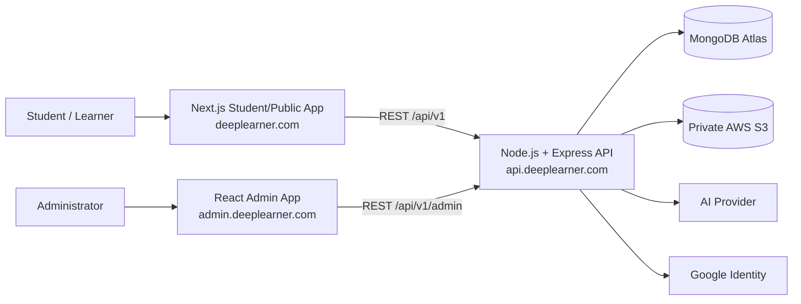

# DeepLearner System Architecture

**Version:** 1.0  
**Status:** Architecture baseline for implementation  
**Parent document:** DeepLearner PRD v1.0  
**Database detail:** Deliberately deferred to the next Database Architecture document

**2026-10-31 documentation amendment:** Section 32 records the owner-approved
Studio/Interview and persistent LOCAL design targets. It qualifies earlier manual
authoring and synchronous-only product assumptions, not existing implemented
contracts, evidence or execution permissions. No application/runtime work is authorized.

---

## 1. Purpose

This document defines the system-level architecture for **DeepLearner**, a visual-first technical learning platform for engineering/IT students and working professionals. It translates the approved PRD into an implementation architecture covering application topology, frontend and backend responsibilities, REST APIs, authentication, authorization, AI integration, visualization, code execution boundaries, media storage, security, deployment, observability, performance, and future scalability.

Detailed MongoDB collection design, embedding vs. referencing decisions, indexes, and progress/practice schemas are intentionally deferred to the next **Database Architecture** design phase.

## 2. Architecture Goals

1. Keep the first production architecture simple enough for a small team and approximately 1,000 initial users.
2. Preserve strong module boundaries so the monolith does not become a tightly coupled codebase.
3. Optimize public learning pages for SEO and fast discovery.
4. Keep the Admin application independent from public/student concerns.
5. Use a single backend API for Student and Admin clients.
6. Keep AI provider credentials and logic exclusively on the backend.
7. Make visual learning a first-class subsystem rather than embedding arbitrary generated UI code in content.
8. Protect student data, AI spending, and administrative workflows from abuse.
9. Keep infrastructure inexpensive during development while retaining a clear production migration path.
10. Avoid microservices, Redis, queues, and distributed infrastructure until an actual scaling or reliability need appears.

## 3. Architecture Principles

- **Modular monolith over microservices.** One Node.js backend deployment with clear domain modules.
- **API-first integration.** Next.js Student/Public and React Admin clients consume versioned REST APIs.
- **Backend authorization is authoritative.** UI visibility is not treated as a security boundary.
- **Provider abstraction.** AI, media, email, and identity integrations are isolated behind adapters.
- **Validated structured data.** API payloads and AI structured outputs are validated before entering business workflows.
- **Secure by default.** Secrets never reach browsers; sensitive routes are authenticated, authorized, validated, and rate limited.
- **Progressive complexity.** No Redis, workers, queues, or microservices in V1 unless a measured need emerges.
- **Public SEO, private operations.** Student/public experience uses Next.js; Admin remains a private React SPA.

## 4. Locked Technology Decisions

| Area | Decision |
|---|---|
| Repository | One GitHub monorepo |
| Package manager | npm with npm workspaces |
| Student/Public application | Next.js + TypeScript |
| Student/Public domain | `deeplearner.com` |
| Admin application | React + TypeScript + Vite |
| Admin domain | `admin.deeplearner.com` |
| Backend | Node.js + Express + TypeScript |
| API domain | `api.deeplearner.com` |
| Backend architecture | Modular monolith |
| API style | REST, versioned under `/api/v1` |
| Database | MongoDB Atlas managed cluster |
| ODM | Mongoose |
| Validation | Zod |
| Password hashing | Argon2id |
| Authentication | DeepLearner-managed email/password + Google OAuth/OIDC |
| Sessions | Short-lived access token + HttpOnly refresh-token cookie + MongoDB session record |
| Authorization | RBAC + feature entitlements |
| Media | Private AWS S3 bucket for images, SVGs, and GIFs |
| Visual diagrams | React Flow + SVG |
| Animation | Framer Motion |
| Advanced visualization | D3 only where required |
| Code editor | Monaco Editor |
| AI | Backend provider abstraction, Admin-only generation in V1 |
| Queue | None initially |
| Redis | None initially |
| Microservices | None initially |
| Video hosting | Not in V1 |

## 5. System Context



## 6. Application Topology

DeepLearner has **two frontend clients and one backend application**.

### 6.1 Student/Public Application

**Technology:** Next.js + TypeScript  
**Domain:** `deeplearner.com`

Responsibilities:

- Landing page and public marketing content
- SEO-friendly public lessons
- Registration and login experiences
- Student dashboard
- Learning paths
- Read / Visualize / Example / Practice / Revise experiences
- Interview preparation
- Notes, bookmarks, and highlights
- Progress and gamification UI
- JavaScript/TypeScript playground

Next.js is used because the public-learning side benefits from server rendering/static generation, metadata control, public route discoverability, and SEO.

### 6.2 Admin Application

**Technology:** React + TypeScript + Vite  
**Domain:** `admin.deeplearner.com`

Responsibilities:

- Admin dashboard
- Content authoring
- AI draft generation
- Review / approval / publish workflows
- Learning-path management
- Interview-question management
- Visualization selection and preview
- Student/account operations
- Aggregate analytics
- Content-quality alerts
- Reported-content review
- Audit-log viewing

The Admin application is intentionally separate because it does not require SEO or public rendering and can evolve independently as a dashboard-heavy SPA.

### 6.3 Shared Backend

**Technology:** Node.js + Express + TypeScript  
**Domain:** `api.deeplearner.com`

The backend is the authoritative source for:

- Authentication and sessions
- Authorization
- Business rules
- Content workflow
- Progress calculations
- Practice attempts
- AI generation
- Media authorization
- Analytics ingestion
- Audit logging
- Database access

Both Student and Admin applications call the same backend.

## 7. Monorepo Structure

```text
deeplearner/
├── apps/
│   ├── web/                 # Next.js student/public app
│   ├── admin/               # React + Vite admin app
│   └── api/                 # Node.js + Express API
│
├── packages/
│   ├── shared-types/        # Shared TypeScript contracts
│   ├── validation/          # Reusable Zod schemas where appropriate
│   └── config/              # Shared non-secret configuration helpers
│
├── package.json             # npm workspaces
├── .gitignore
├── .env.example
└── README.md
```

The repository is one unit of source control, but each application can be deployed independently.

## 8. Backend Modular-Monolith Design

The Node.js API remains one deployable application but is split by business capability.

Recommended modules:

```text
auth/
users/
technologies/
learning-paths/
content/
visualizations/
practice/
progress/
interview/
notes/
bookmarks/
highlights/
gamification/
notifications/
search/
ai/
media/
analytics/
content-reports/
subscriptions/
audit/
```

### 8.1 Layering

```text
HTTP Request
    ↓
Route / Controller
    ↓
Middleware
  - authentication
  - authorization
  - validation
  - rate limiting
  - request correlation
    ↓
Application / Domain Service
    ↓
Repository / Persistence Boundary
    ↓
MongoDB Atlas / External Adapter
```

**Controllers** translate HTTP to application requests.  
**Services** own business rules and workflows.  
**Repositories** isolate Mongoose/database access.  
**Adapters** isolate third-party providers such as S3, Google, and AI.

No route should directly implement substantial business logic or call Mongoose models across unrelated modules.

## 9. REST API Design

Base path:

```text
/api/v1
```

Representative Student routes:

```text
GET    /api/v1/technologies
GET    /api/v1/learning-paths/:id
GET    /api/v1/concepts/:id
POST   /api/v1/practice/:questionId/attempt
GET    /api/v1/progress
POST   /api/v1/bookmarks
POST   /api/v1/notes
POST   /api/v1/content-reports
```

Representative Admin routes:

```text
GET    /api/v1/admin/dashboard
POST   /api/v1/admin/concepts
PUT    /api/v1/admin/concepts/:id
POST   /api/v1/admin/concepts/:id/approve
POST   /api/v1/admin/concepts/:id/publish
POST   /api/v1/admin/ai/generate
GET    /api/v1/admin/analytics
GET    /api/v1/admin/reports
```

### API conventions

- JSON request/response payloads
- Resource-oriented URLs
- Explicit HTTP status codes
- Pagination for list endpoints
- Versioning under `/api/v1`
- Consistent error envelope
- Server-generated request/correlation ID
- Zod validation on all untrusted payloads
- Backend validation remains authoritative even if clients share schemas

Example error envelope:

```json
{
  "error": {
    "code": "VALIDATION_ERROR",
    "message": "Request validation failed",
    "requestId": "...",
    "details": []
  }
}
```

## 10. Authentication Architecture

DeepLearner owns its authentication and session model.

### 10.1 Email/Password

1. User submits email/password over HTTPS.
2. Backend validates the payload.
3. Password is verified using Argon2id.
4. Backend creates/rotates a server-side session record.
5. Backend issues a short-lived access token.
6. Backend sets a Secure, HttpOnly refresh-token cookie.
7. Client uses the access token for protected API calls.
8. When the access token expires, the refresh flow validates the refresh cookie and server-side session before issuing a new access token.

### 10.2 Google Login

Google OAuth/OIDC is integrated through an audited/supported library. DeepLearner does not invent its own OAuth protocol implementation.

1. User chooses Continue with Google.
2. Google authenticates the user.
3. Backend validates the Google identity result.
4. DeepLearner finds or creates its own user.
5. DeepLearner creates its own session and token set.

Google establishes identity; DeepLearner remains responsible for application authorization and sessions.

### 10.3 Session Model

Refresh tokens are not treated as permanently valid bearer strings. A server-side session record enables:

- Logout
- Session revocation
- Token rotation
- Password-change invalidation
- Logout-all-devices functionality (F009)

Detailed session collection fields are deferred to Database Architecture.

## 11. Authorization and Entitlements

Two different concepts are maintained:

- **Role**: what administrative authority a user has (`STUDENT`, `ADMIN`)
- **Entitlement**: what product features a plan grants

Example:

```text
Role: STUDENT
Plan: PREMIUM
Entitlements:
  - visual_learning
  - advanced_practice
  - interview_module
  - code_visualizer
```

Admin endpoints require backend checks such as:

```text
authenticate
    ↓
requireRole("ADMIN")
    ↓
controller
```

The Admin UI hiding buttons is not considered a security control.

During development, all users may be granted premium entitlements while the entitlement engine remains active.

## 12. Content Lifecycle Architecture

Content follows a controlled workflow:

```text
DRAFT
  ↓
AI_GENERATED (when AI is used)
  ↓
IN_REVIEW
  ↓
APPROVED
  ↓
PUBLISHED
  ↓
ARCHIVED
```

Additional state:

```text
CHANGES_REQUIRED
```

Important invariant:

> No AI operation may directly publish content.

Only `PUBLISHED` content is visible to students.

## 13. AI Architecture

AI is an **Admin-side content-assistance capability** in V1.

### 13.1 Provider abstraction

Business modules call an internal AI service rather than directly calling a vendor SDK.

```text
Content Service
      ↓
AI Service
      ↓
AI Provider Adapter
      ↓
OpenAI / future provider
```

Representative operations:

```text
generateReadExplanation()
suggestVisualization()
generateExamples()
generatePracticeQuestions()
generateRevisionMaterial()
generateFlashcards()
generateInterviewQuestions()
```

### 13.2 Structured output

Where AI produces machine-consumed data, the output must be parsed and validated before storage.

```text
AI Provider
    ↓
Structured response
    ↓
Zod validation
    ↓
Accepted draft OR rejected/regenerated result
```

### 13.3 AI security and cost controls

- AI keys exist only in backend secrets
- Admin authentication required
- `ADMIN` role required
- Per-route rate limits
- Daily/internal usage quotas
- Server-side model selection
- Output/token limits
- Separate DEV and PROD keys/projects
- Usage and estimated-cost logging
- No secret values in logs
- Human approval before publication

No student-facing live AI tutor exists in V1.

## 14. Visualization Engine Architecture

Visual learning is implemented as structured data plus trusted renderers.

```text
Concept
   ↓
Visualization reference/specification
   ↓
Validated visualization JSON
   ↓
Renderer Registry
   ├── Flow / Architecture Renderer
   ├── Mind Map Renderer
   ├── Timeline Renderer
   ├── Sequence Renderer
   ├── Execution Renderer
   └── Chart / Data Renderer
   ↓
Playback Controller
```

Core technology:

- React Flow for node/edge and architecture-style diagrams
- SVG for custom diagrams and execution visualizations
- Framer Motion for motion/step transitions
- D3 only for visualizations that genuinely require it

### 14.1 Security principle

AI does **not** generate arbitrary React/JavaScript and send it to students for execution.

Instead, AI may suggest validated structured visualization data that is rendered by DeepLearner-owned components.

### 14.2 Playback controls

Where supported:

- Play
- Pause
- Previous Step
- Next Step
- Replay
- Speed

Reduced-motion and non-animated fallbacks should remain possible.

## 15. Code Visualizer and Playground

### 15.1 Editor

The student playground uses Monaco Editor for JavaScript and TypeScript authoring.

### 15.2 Execution boundary

Arbitrary student code must **not** execute directly inside the production Node.js API process.

For V1, prefer browser-side/sandboxed execution for supported JavaScript/TypeScript use cases.

### 15.3 Code Visualizer

The Code Visualizer is conceptually separate from the raw editor. It can present controlled representations such as:

- Execution contexts
- Scope chains
- Closures
- Call stack
- Event-loop movement
- Promise lifecycle
- Variable state changes

A future secure server-side execution service, if required, should be designed separately and isolated from the main API.

## 16. Media Architecture

Supported V1 media:

- Images
- SVG
- GIF

Video hosting is excluded.

### 16.1 Storage

Files live in a private AWS S3 bucket. MongoDB stores metadata and object keys rather than file binaries.

### 16.2 Upload flow

1. Admin authenticates to DeepLearner API.
2. Admin requests an upload authorization.
3. Backend validates role, media type, and size constraints.
4. Backend returns a short-lived presigned S3 upload URL.
5. Browser uploads directly to S3.
6. DeepLearner stores media metadata in MongoDB.

Permanent AWS credentials never reach either frontend.

### 16.3 Delivery

During development, controlled S3 delivery is sufficient. A CDN such as CloudFront can be introduced later when traffic, latency, or caching needs justify it.

## 17. Data Persistence - High Level Only

DeepLearner uses a managed MongoDB Atlas cluster accessed through Mongoose repositories.

At this architecture level, data domains include:

- Identity and sessions
- Technologies and learning paths
- Modules/topics/concepts
- Visualizations
- Practice questions and attempts
- Student progress
- Notes/bookmarks/highlights
- Interview content
- Gamification
- Notifications
- AI usage
- Media metadata
- Content reports
- Audit events
- Plan/entitlement data

**This document intentionally does not decide:**

- exact collection boundaries
- embedded vs referenced documents
- indexes
- unique constraints
- schema field definitions
- progress aggregation strategy
- practice-attempt storage model
- visualization document granularity

Those are deferred to Database Architecture.

## 18. Analytics and Event Architecture

V1 should capture meaningful product events without introducing a separate analytics platform.

Representative events:

```text
user_registered
learning_path_started
concept_started
read_completed
visualization_started
visualization_completed
practice_submitted
answer_revealed
concept_completed
concept_revisited
bookmark_added
note_created
content_reported
badge_earned
```

Initial flow:

```text
Student/Admin action
      ↓
Backend business operation
      ↓
Analytics/Event service
      ↓
MongoDB persistence / aggregate computation
```

Events should not block critical user actions where avoidable. If event volume grows substantially, analytics can later move behind a queue or dedicated store.

## 19. Logging and Observability

V1 should use structured server logs.

Recommended fields:

```text
timestamp
level
requestId
module
action
userId (when safe/needed)
status
durationMs
```

Never log:

- Passwords
- Password hashes
- Full access/refresh tokens
- Google tokens
- AI API keys
- AWS secret keys
- Sensitive request bodies by default

Recommended V1 observability:

- Structured application logs
- Central error tracking
- Health endpoint
- Request latency
- AI usage metrics
- Authentication failure rates
- Content-publish failures
- S3 upload failures

## 20. Security Boundaries

### Internet-facing boundaries

- `deeplearner.com`
- `admin.deeplearner.com`
- `api.deeplearner.com`

### Critical controls

- HTTPS only
- Strict CORS allowlist for known frontend origins
- Secure headers
- API request-size limits
- Zod input validation
- Authentication rate limits
- Admin AI rate limits and quotas
- Backend RBAC
- HttpOnly refresh cookies
- Short-lived access tokens
- Argon2id password hashing
- Secret separation by environment
- Private S3 bucket
- Presigned uploads
- Sanitized error responses
- Audit logs for privileged actions

### Admin-specific controls

Admin authorization must be enforced on the API, not only on `admin.deeplearner.com`.

## 21. Caching and Performance

V1 avoids distributed cache infrastructure.

Recommended initial approach:

- Next.js rendering/cache capabilities for public content
- HTTP/browser caching for immutable assets
- S3 cache headers for media
- MongoDB indexes selected during Database Architecture
- Pagination for large lists
- Lazy loading for heavy visualization/editor libraries
- Route/code splitting
- Avoid loading Monaco, D3, or complex visualization code on pages that do not need them

Redis is explicitly deferred until a concrete use case appears.

## 22. Background Work

V1 does not require a queue/worker system.

Initial AI flow may remain synchronous for Admin content generation, with sensible timeouts and status handling.

A queue becomes appropriate when:

- AI generation jobs are long-running or concurrent
- media processing is introduced
- email volume grows
- analytics/event volume grows
- scheduled jobs become common

The backend module design should allow adding workers later without changing public API contracts.

## 23. Failure Handling

### API

- Consistent error envelope
- Correlation/request ID
- No internal stack traces exposed to clients
- Retry only idempotent operations where safe

### Authentication

- Invalid/expired access token -> unauthorized response
- Valid refresh session -> token refresh
- Revoked/expired refresh session -> reauthentication required

### AI

- Provider timeout/failure must not corrupt content state
- AI generation remains a draft operation
- Invalid structured output is rejected or regenerated
- Provider outage must not prevent students from reading already-published content

### S3

- Failed uploads must not create published media references
- Orphaned upload cleanup can be added later

### MongoDB

- Database failures should return controlled service errors
- Business operations requiring consistency should be designed carefully during Database Architecture

## 24. Environment Strategy

Logical environments:

```text
LOCAL
DEVELOPMENT
PRODUCTION
```

`STAGING` can be introduced before public production when release complexity warrants it.

Environment isolation:

- Separate MongoDB databases/clusters as appropriate
- Separate AI keys/projects
- Separate S3 prefixes/buckets or strong environment prefixes
- Separate Google OAuth configurations where needed
- Separate secrets

Local secrets belong in `.env` files excluded from Git. Hosted environments use provider secret/environment-variable management.

## 25. Deployment Architecture

### Development recommendation

```text
GitHub monorepo
  ├── apps/web   -> Next.js-friendly hosting (e.g. Vercel)
  ├── apps/admin -> static/React hosting (e.g. Vercel)
  └── apps/api   -> Node.js hosting suitable for Express

External managed services:
  MongoDB Atlas
  AWS S3
  AI Provider
  Google Identity
```

The architecture intentionally keeps the application portable. The backend can later move to AWS or another Node-compatible environment without rewriting the application domain model.

### Production evolution

Potential future path:

```text
DNS / Edge / WAF
      ↓
Student Next.js       Admin React
      \                 /
       \               /
         Node.js API
          /   |   \
   MongoDB   S3   AI Provider
```

CloudFront/WAF/centralized observability can be introduced when production traffic and risk justify them.

## 26. Scalability Strategy

For approximately 1,000 initial users, the modular monolith is expected to be sufficient.

Scale in this order:

1. Optimize queries and indexes.
2. Scale Node application instances vertically/horizontally as needed.
3. Introduce CDN/cache improvements.
4. Add queue/worker infrastructure for genuinely asynchronous workloads.
5. Separate high-load modules only when measured bottlenecks justify service extraction.

Potential future extraction candidates:

- AI generation worker/service
- analytics pipeline
- secure code execution service
- notification/email worker

Microservices are not a roadmap goal by themselves.

## 27. Key Tradeoffs

### Separate Next.js Student app and React Admin app

**Benefits:** SEO where needed, simpler Admin SPA, independent release/UI evolution.  
**Cost:** two frontend deployments and some shared-contract management.

### Separate Express backend instead of Next.js-only backend

**Benefits:** clean client-agnostic REST boundary, easier future mobile/PWA clients, central Student/Admin business logic.  
**Cost:** one additional deployable application.

### Custom authentication

**Benefits:** control of user/session model and no hosted-auth dependency.  
**Cost:** more security responsibility, testing, token lifecycle management, and email flows.

### MongoDB Atlas

**Benefits:** managed operations and good fit for flexible content structures.  
**Cost:** schema discipline and relationship modeling must be intentionally designed.

### No queue/Redis in V1

**Benefits:** simpler deployment and debugging.  
**Cost:** long-running operations may need redesign later.

## 28. Architecture Decision Records (ADRs)

### ADR-001 - Modular Monolithic Backend

**Decision:** One Node.js/Express backend with internal modules.  
**Reason:** Current team/scale does not justify microservice operational complexity.  
**Future trigger:** Extract only measured bottlenecks or isolation-sensitive workloads.

### ADR-002 - Next.js for Student/Public Application

**Decision:** Next.js + TypeScript.  
**Reason:** Public learning pages need SEO, metadata, and rendering flexibility.

### ADR-003 - React SPA for Admin

**Decision:** React + TypeScript + Vite.  
**Reason:** Admin is private, dashboard/form-heavy, and does not require SSR/SEO.

### ADR-004 - Shared REST Backend

**Decision:** Student and Admin use the same versioned API.  
**Reason:** Single source of business truth and authorization.

### ADR-005 - DeepLearner-managed Authentication

**Decision:** Custom email/password/session model; Google used only as an identity provider.  
**Reason:** Product controls session and authorization behavior.

### ADR-006 - MongoDB Atlas + Mongoose

**Decision:** Managed MongoDB cluster with Mongoose data access.  
**Reason:** Operational simplicity and document-oriented content fit.

### ADR-007 - Private S3 Media Storage

**Decision:** Images/SVG/GIF in private S3, uploaded through presigned URLs.  
**Reason:** Avoid application-server file streaming and credential exposure.

### ADR-008 - Structured Visualization Specs

**Decision:** Render trusted structured visualization data; never execute arbitrary AI-generated UI code.  
**Reason:** Security, consistency, editability, and renderer reuse.

### ADR-009 - AI as Admin Assistant in V1

**Decision:** AI generation is Admin-only and requires human approval.  
**Reason:** Content quality, cost control, and safety.

### ADR-010 - No Redis / Queue Initially

**Decision:** Keep V1 synchronous and infrastructure-light.  
**Reason:** Current traffic and workflows do not justify distributed infrastructure.

## 29. Deferred to Database Architecture

The next design document must explicitly decide:

1. Collection boundaries for technology, learning path, module, topic, concept, and visualization.
2. Embedded documents vs. references.
3. User and session collections.
4. Student-progress representation and update strategy.
5. Practice-question and practice-attempt modeling.
6. First/latest/best score representation.
7. Learning-path ordering and prerequisite relationships.
8. Visualization-spec storage and versioning strategy.
9. Notes/bookmarks/highlights ownership and indexes.
10. Interview-question structure.
11. Gamification/XP/badge persistence.
12. Notification persistence and read-state model.
13. Content-approval and audit data structures.
14. AI usage/cost records.
15. Media metadata model.
16. Aggregate analytics strategy.
17. Indexes, compound indexes, uniqueness, and TTL indexes.
18. Soft-delete/archive conventions.
19. Data-retention rules.
20. Transaction/consistency requirements for multi-document workflows.

## 30. Implementation Sequence

Recommended technical sequence after Database Architecture is approved:

1. Monorepo bootstrap and shared TypeScript/config packages.
2. Node/Express API skeleton and health endpoint.
3. MongoDB connection and repository conventions.
4. Authentication + sessions + Google login.
5. RBAC and entitlement middleware.
6. Core content hierarchy APIs.
7. Next.js public/student shell.
8. React Admin shell.
9. Content workflow and Admin authoring.
10. S3 upload flow.
11. Practice and progress.
12. Visualization engine.
13. AI draft generation and approval integration.
14. Interview module.
15. Gamification/notifications/analytics.
16. Security hardening, observability, and deployment readiness.

## 31. Architecture Baseline

The approved baseline is:

```text
Student/Public: Next.js + TypeScript
Admin:          React + TypeScript + Vite
Backend:        Node.js + Express + TypeScript
Architecture:   Modular Monolith
API:            REST /api/v1
Database:       MongoDB Atlas + Mongoose
Validation:     Zod
Auth:           DeepLearner-managed + Google OAuth/OIDC
Password:       Argon2id
Session:        Access token + HttpOnly refresh cookie + server-side session
Media:          Private AWS S3
AI:             Backend-only provider abstraction, Admin-only in V1
Visualization:  React Flow + SVG + Framer Motion (+ D3 only when needed)
Code editor:    Monaco
Repository:     GitHub monorepo + npm workspaces
Redis/Queue:    Not initially
```

This baseline is stable enough to proceed to **DeepLearner Database Architecture** without revisiting the major system boundaries unless new product requirements materially change them.

## 32. Owner-approved design amendment — 2026-10-31

### 32.1 Authority and preserved boundaries

Documentation-only approval covers the Admin AI Content Studio, separate Interview
Preparation and persistent LOCAL development design. Retain Next.js Student,
React/Vite Admin, Express modular monolith, Mongoose/MongoDB, existing authentication
and versioned REST conventions. The baseline's library list describes intent, not
proof of installed or qualified functionality. No new dependency is selected here.

F042/F043 remain IN_PROGRESS, acceptance BLOCKED; F043 MongoDB 15 NOT_RUN, browser
213 NOT_RUN, live integration and production NOT_VERIFIED, and F044 NOT_STARTED.
Historical contracts, FAIL/UNKNOWN evidence, primary-host Playwright restrictions,
process/Job ownership, fixture isolation, authenticated RESULT/digest ACK, deadlines
and cleanup requirements remain binding. No new sequencing exception is created.

### 32.2 Authoring, generation and publication

Private authoring owns briefs, outline/content revisions, prerequisites, learning
objectives, version targeting, source evidence and review decisions. AI creates
material; Admin supplies correction instructions and approves/rejects exact revisions.
Preserve existing F043 Technology controls until an accepted replacement exists.

Generation services call a provider adapter compatible with OpenAI and future
alternatives; no model is permanently chosen. Validate bounded structured outputs
before draft admission. The provider receives neither Student personal data nor
credentials, database access or publishing capability. Treat retrieved material
and model output as untrusted data, not instructions or approval evidence.

Source retrieval requires a reviewed HTTPS host/path policy, bounded time/bytes and
connection-time destination checks. Deny loopback/private/link-local/metadata targets
and DNS-rebinding bypasses; disable redirects or revalidate every destination.
Do not give the model arbitrary URL fetch, network, credentials or database tools.
Record actual source/claim/version evidence; successful fetch or model confidence
does not establish factual correctness or human approval.

Resumable batches motivate a durable job design; a MongoDB-backed queue with one
supervised executor is the initial proposal, not an implemented worker or automatic
amendment of ADR-010. Keep external calls outside transactions. A later exact-scope
implementation approval must define leases/fencing, bounded job authorization,
current-account checks, expiry/resume, cancellation, dispatch uncertainty and cost
reconciliation. Never persist bearer/refresh tokens as job credentials. Usage
accounting may settle incurred charges without granting content/publishing authority.
Redis, a distributed queue platform and microservices are not required by this design.

Curriculum and Interview share the PRD's INR 1,000 monthly cap: transactional
reservations, bounded exposure, actual settlement, concurrent admission, 80% warning
and hard stop. Unknown charges retain reservations; no automatic cap/model-cost
increase. Rate/FX/tax assumptions require review before any paid call.

Publishing is an explicit Admin service, not a job/provider side effect. It validates
exact approvals, source/quality evidence and immutable revision manifests, then
normalizes content into existing Student read models. A module's promotion and
required audit commit atomically with current-Admin authority fencing and revision
preconditions. Oversized modules refuse rather than partially promote. Unknown
commits require explicit read reconciliation, not blind replay or compensation.
Read-side snapshot/release consistency must also be qualified; multi-request page
consistency is not created merely by transactional writes. Preserve public DTOs,
stable IDs and stored Student history; assess revision-bound qualification before
replacing existing content. No progress migration or general F038 origin is granted.

### 32.3 Separate Interview domain and safe presentation

Technology owns independent InterviewQuestion identities and immutable revisions,
optionally linked to multiple Topics/Concepts. Student browsing/search/filtering,
prepared-answer reveal and published learning links are additive features. No
non-coding submissions, timed mocks or AI grading. Coding alone has planned editor
and Run/Test behavior, gated by a separately reviewed isolation design. No runner
or Interview UI is claimed to exist; arbitrary code must never run in Express or
with internal credentials. Public browser feedback cannot become trusted grades.

Publish one question, selected questions or a frozen all-eligible manifest. Every
question retains individual review; bound operations, revalidate eligibility and
report per-item conflicts, failures and unknown outcomes. This is not a sixth mode.

Admin Student Preview must reuse trusted presentation without real Student writes.
The minimal shared-renderer extraction and any new routes/packages remain future
approval decisions. Existing Student guards stay intact. Only ANIMATED_FLOW v1
and four existing Practice types may be presumed supported; additional renderers,
interactive MCQs and general persistent qualification need separate scoped work.

### 32.4 Permanent LOCAL design target and tooling separation

| Component         | Approved design target; not a running environment                 |
| ----------------- | ----------------------------------------------------------------- |
| Student           | http://127.0.0.1:3000                                             |
| Admin             | http://127.0.0.1:5173                                             |
| API               | http://127.0.0.1:4000/api/v1                                      |
| MongoDB software  | Existing 8.2.7 installation                                       |
| Distinct instance | Loopback 127.0.0.1:27019, deeplearner-dev-rs, deeplearner-dev     |
| Storage           | Private persistent Windows-user DeepLearner/dev directory         |
| Credentials       | Separate scoped DB credentials; private stable API signing secret |

Installation/service identity, startup policy, ACLs, replica initialization, database
connections and writes require separate owner approvals. Port availability remains
UNKNOWN. Never alter/adopt protected 27017 or legacy local-demo/test 27018, their
data or ownership receipts. A matching stored receipt is not live process ownership.

Proposed dev:local starts only owned foreground applications/package watchers, with
hot reload, stable ports, bounded readiness and no runtime expiry. MongoDB remains
separate. Refuse unidentified occupied ports; never adopt listeners or kill by name.
Reuse existing retained-handle/native Job primitives for application cleanup, not
the disposable test runner or its CIM/RESULT/ACK apparatus. Qualify Ctrl+C/watcher
shutdown; forced containment is not graceful success. Startup performs no account,
index or seed provisioning and never loads an unreconciled API .env into this profile.
Provide API secrets only to the API/check helper, never frontends or package watchers.

Proposed dev:setup is an explicit one-time/reconciliation operation. The narrow named
persistent-index proposal in DATABASE_DESIGN.md is NOT ACTIVE; existing provisioning
prohibitions still apply. Detailed staged file inventories, secret handling, genuine
authentication, seed limits and manual QA are in LOCAL_DEVELOPMENT.md. No service
manager is introduced for the apps. Native MongoDB service management itself remains
separately reviewed, including startup policy and privileges.

Persistent developer data and disposable automated qualification are separate modes.
Manual Chrome demonstrations are required supplemental evidence for future UI work,
not replacements for formal database/security/browser acceptance or release review.

## 33. Local Development Slice A startup checkpoint — 2026-10-31

Owner-approved startup-tooling implementation at HEAD 41d78aae50715f6ad3b1deac1587cc215918aa9f
uses root `npm run dev`, replacing the root concurrently orchestration with the
guarded `scripts/Start-DeepLearnerDev.ps1`. This is the approved current command;
the earlier proposed root dev:local/dev:setup interfaces remain unimplemented.
The owner explicitly extended Slice A to `apps/api/package.json`: new API-only
dev:local preserves watch/tsx/server startup without automatic `.env` loading.
Existing API dev and all application/authentication contracts remain unchanged.

The launcher reuses current package builds/watchers and Next/Vite workspace scripts,
with fixed loopback ports 3000/5173/4000 and independent child environments. Its
import-safe TypeScript helper validates the private fixed-target profile, scripts
and private credentials through a bounded stdin pipe; it imports no product/database
code and returns only a public process plan. Current-user DPAPI/private profile
creation, MongoDB instance/schema provisioning, accounts and sample content remain
future separately approved stages. Metadata does not prove current database ownership,
topology or indexes. The named provisioning policy remains PROPOSED / NOT ACTIVE.

Reuse the existing native Windows Job/retained handles unchanged. Retain an exclusive
startup lock through cleanup, refuse unknown occupied ports, require post-spawn
loopback/Job membership and fail if ownership inspection is unavailable. No listener
adoption or external-service termination is permitted. Initial startup is bounded;
normal owned-listener gaps during hot reload get a bounded 60-second recovery window.
Steady-state lifetime has no demo expiry. Listener presence alone is not readiness
or acceptance. Ambient frontend dotenv/npm configuration and preload options refuse
or are isolated; backend secrets reach only the validator/API child.

Slice A intentionally reports Windows stop as FORCED_CONTAINMENT of only its Job.
The existing workspace CLI watchers expose no qualified graceful stop channel here;
do not label this graceful or reinterpret the earlier graceful target as achieved.
Interactive Ctrl+C, full watcher recovery and real API/UI startup qualification are
outstanding. Observed root startup fails closed at DEV_PROFILE_MISSING, before any
app or database execution. See LOCAL_DEVELOPMENT.md for source scope/evidence.
No service, .env, persistent configuration, database or application source changes
are included; all existing feature statuses and acceptance restrictions remain.

## 34. Persistent first-user bootstrap preparation — 2026-10-31

The owner approved offline implementation of a bounded bootstrap coordinator in
existing Setup-DeepLearnerDev.ps1 and an import-safe internal Node protocol helper.
No general-purpose supervisor, application API/security business-logic change,
new dependency or runtime approval is included. Both execution guards remain
unconditional refusals; DEV-PERSISTENT-27019 is PROPOSED / NOT ACTIVE.

Phase 1: the exact dedicated virtual-account Windows service binds 127.0.0.1:27019
with authorization/keyFile, requireTLS and mandatory private-CA client certificates.
The client verifies the CA, server hostname/SAN, expiry, leaf key match and pinned
certificate fingerprint. It also requires a specific certificate-rejection response
from a no-client-certificate probe; generic transport failure is UNKNOWN.
MongoDB's localhost exception supplies first-user authorization inside that channel.
The owner, SYSTEM/Administrators and dedicated MongoDB service are trusted principals;
this is not isolation from hostile code running as the Windows owner.

Phase 2: only after actual operator/app authentication and exact privilege inspection,
the same stopped service receives the known normal LOCAL/SCRAM configuration with
localhost bypass disabled. No TLS-error-to-plaintext fallback exists. Configuration
phase is derived from exact file bytes, not a CLI flag or optimistic receipt.
A normal config after interruption is authenticated and completed without ever
restoring bootstrap mode. Ordinary service start/reuse always performs fresh
normal authentication; npm run dev never bootstraps or manages MongoDB.

The helper receives bounded private stdin under existing retained Job containment.
Only fixed public status frames return; stderr is discarded and raw driver/server
errors never enter logs. Parent checks SCM/image/listener/storage/artifact identity
around each helper invocation. The helper alone does not prove SCM/storage ownership.
No direct public helper invocation or independent Node-only activation is approved.

DPAPI passwords are durable before first network write; TLS CA signing key is
DPAPI-protected, leaf PEM keys use explicit private ACLs, server key/internal key
are service-readable and client/operator/app material is owner-only. Certificate
stores and machine-wide trust are unchanged. Native service permissions grant only
owner query/start/stop/interrogate/synchronize/read-control on this new service.
SCM owner/live DACL are validated before reuse and before/after the grant; unrelated
controlling permissions (including generic execute/write/all) refuse. The exact-
service read-only native adapter has bounded buffers and retained handle cleanup.
Install/elevation/logon/ACL behavior requires separately approved real qualification.

Inert/mocked evidence is not TLS, authentication, service, transaction or persistence
verification. F042/F043 acceptance BLOCKED,15 MongoDB/213 browser NOT_RUN and
F044 NOT_STARTED remain unchanged; production readiness remains NOT_VERIFIED.

## Inactive local provisioning authorization boundary — 2026-11-01

The owner-approved ten-file source amendment is offline only. Both runtimes retain
PROPOSED / NOT ACTIVE policy version 1. PowerShell's literal source metadata and
Node's strict source definition must agree on identity, status, version, exact
27019 target and five operations before effects. PS's Plan and Node's
--check-policy expose only their own definitions. The Node effect CLI reads the
single PS literal instead of launching another interpreter, avoiding recursion
or an additional runtime-path configuration.

A private, per-invocation CLI lease binds action/target/OS Windows SID. Dot-source,
imports, direct exported calls and JSON/profile/environment objects have no issuer.
PS installs its context-bearing guard only inside its actual CLI try/finally;
Node accepts only its private WeakSet identity. Finally revokes/restores these
contexts; process exit also ends their memory lifetime. Contexts carry no secrets.
The internal Node CLI uses an explicit fixed step argument which must match strict
private stdin; it independently derives owner SID and checks the existing private
manifest/source hash/certificate pins. It is not an independently authorized
provisioning route or proof of the PS parent Job/live SCM ownership. The existing
PS service/image/listener/storage/ACL checks before and after each child remain
mandatory. Same-owner and SYSTEM/Administrator trust assumptions are unchanged.

Action-specific guards and exact artifact-path allowances prevent ordinary service
operations from creating bootstrap secrets or changing transport. Legacy replica
initialization always refuses. Existing mTLS/keyfile/authentication, DPAPI,
creation-time service DACL/readback, restricted role, interruption handling and
protected-service exclusions are preserved. Normal npm run dev never bootstraps.

Offline positive cases use memory/local mocks, never accepted live contexts.
Host SID/service/TLS/auth/transaction/persistence behavior remains NOT_RUN /
NOT_VERIFIED. Source activation, runtime execution, Git delivery and feature
acceptance remain separate approvals. MongoDB NOT_PROVISIONED; F042/F043
acceptance BLOCKED; F044 NOT_STARTED; production NOT_VERIFIED.

## Source-policy ACTIVE; execution gate unchanged — 2026-11-01

Owner-approved nine-file offline amendment changed only the two policy status
literals to ACTIVE after activation-safe fixture corrections/checks passed. Policy
version 1, exact 27019 target, five operations and all guard/actuator code remain
unchanged. Earlier inactive-state architecture records above are historical.
No production source, API/authentication logic, dependencies, permits or environment
switches changed.

ACTIVE is source authorization only, not runtime execution permission. Every
PrepareStorage/InstallService/StartService/StopService/BootstrapFirstUser invocation
requires separate owner approval and current host qualification. Imports/dot-source
and exported calls cannot issue accepted CLI contexts. Contexts bind exact action,
target and OS-derived owner; cleanup, cross-source mismatch refusals and permanent
legacy initialization refusals remain intact. Node owner/manifest binding still
is not PS parent/live SCM proof; mandatory PS ownership checks remain unchanged.
Protected 27017/27018 resources remain excluded.

Positive provisioning tests remain memory/local mocks; no accepted production
context or live provisioning action is executed. Retained startup tests use only
temporary fixtures and harmless owned validator children. Earlier inactive results
remain intact; current pre/post activation evidence is in LOCAL_DEVELOPMENT.md.
No MongoDB/service/ACL/certificate/credential operation or application startup ran.

Source deactivation does not stop an existing service and blocks guarded stop
operations too; any needed verified-owned-service shutdown requires separate
approval. No automatic rollback of persistent files, users or data is permitted.
MongoDB NOT_PROVISIONED; real host/service/TLS/authentication/transactions/persistence
NOT_VERIFIED; app startup/shutdown NOT_VERIFIED; F042/F043 acceptance BLOCKED;
F043 MongoDB 15 NOT_RUN; browser 213 NOT_RUN; F044 NOT_STARTED; production NOT_VERIFIED.
## Manual MongoDB lifecycle — offline amendment, 2026-11-01

Prefer an owner-managed foreground MongoDB process to further service installation.
Reuse the existing LocalProcessOwner native helper; no new supervisor/dependency.
The new manual policy is separately INACTIVE; the ACTIVE service policy is unchanged.
Manual contexts bind exact action/target/OS owner and are issued only by the actual
PS CLI after PS/Node policy agreement, then revoked in finally. Node retains a
separate private manual context; imports/synthetic ACTIVE facts issue none.

The PS coordinator retains original Child handles, creation/image/Job observations
and checks literal 27019 listener ownership before/after helper operations. The
helper's existing no-window process model uses authenticated shutdown, not an
assumed console signal. Only retained owned Job containment is an error fallback.
An old PID/receipt is never adopted. The source sidecar also pins the unmodified
native owner helper, original manifest digest and all current execution sources.

Original service-bound private metadata remains immutable provenance. Manual-only
sidecar and staged results provide explicit reviewed compatibility; no silent pin
migration or credential regeneration. Shutdown-role permissions are operator-only.
Bootstrap mTLS transitions to loopback SCRAM WITHOUT TLS; non-loopback use is excluded.
Normal-operation TLS remains a separate hardening decision. All runtime results
are NOT_VERIFIED until qualified execution. B incomplete; C–F NOT_RUN;
F042/F043 acceptance BLOCKED; F044 NOT_STARTED; production NOT_VERIFIED.

## Approved diagnostic/recovery amendment — 2026-11-01

The owner directly approved preserving the binding/intent/data, bounded sanitized
error diagnostics and replica inspection without initialization replay. Manual
policy version 2 adds only BindRecoverySources and InspectOwnedMongo; the revised
source starts INACTIVE pending focused checks and independent review. Service
policy remains unchanged. No recovery operation ran during source preparation.

Generation0 manual-runtime.json and the original initialize-intent remain immutable,
pinned by exact SHA-256. A creation-only manual-recovery-v1.json references both,
the original manifest, current source hashes and original owner. It does not refresh
or overwrite the old binding. Unexpected later/legacy/unknown records, changed
original eleven-file/ACL fingerprint or a pending transition refuse before binding
or restart. No automatic generation migration is permitted by normal startup.

The explicit inspector issues only replSetGetStatus, replSetGetConfig and hello.
Exact94 means NOT_INITIALIZED at inspection time; exact target/config/PRIMARY means
INITIALIZED_PRIMARY. Neither result proves absent users or authorizes deletion of
intent. Starting mongod can recover Mongo-managed journal/catalog files even when
all inspection commands are read-only. Until shutdown authority is established,
inspection cleanup is explicitly FORCED_OWNED_JOB, never graceful/persistence PASS.

Any subsequent separately approved bootstrap re-reads state on the freshly owned
process. It never initializes an already initialized node. A fresh exact94 permits
one new original94-gated attempt, recorded append-only before the command. A second
uncertain reconciled attempt stops before startup. Old intent and old binding are
preserved; no initialization is emitted by the inspection protocol itself.

Manual helper failures now return only fixed phase, DEV_* gate and bounded error
code fields; no raw message, argv, request, credential or stack is exposed. The TLS
negative probe retains strict CA/hostname/server-pin validation and a positive
certificate-bearing connection. It requires a fresh append-only bounded log suffix,
exact probe local-port/connectionId correlation with certificate rejection event23280,
and retained process ownership around the helper. secureConnect, arbitrary reset,
old log rows, timeout, rotation, truncation/regrowth and unknown closes are not proof.

Recovery execution and B–F completion remain NOT_VERIFIED until actual qualified
runs. F042/F043 acceptance BLOCKED; F044 NOT_STARTED; production NOT_VERIFIED.
